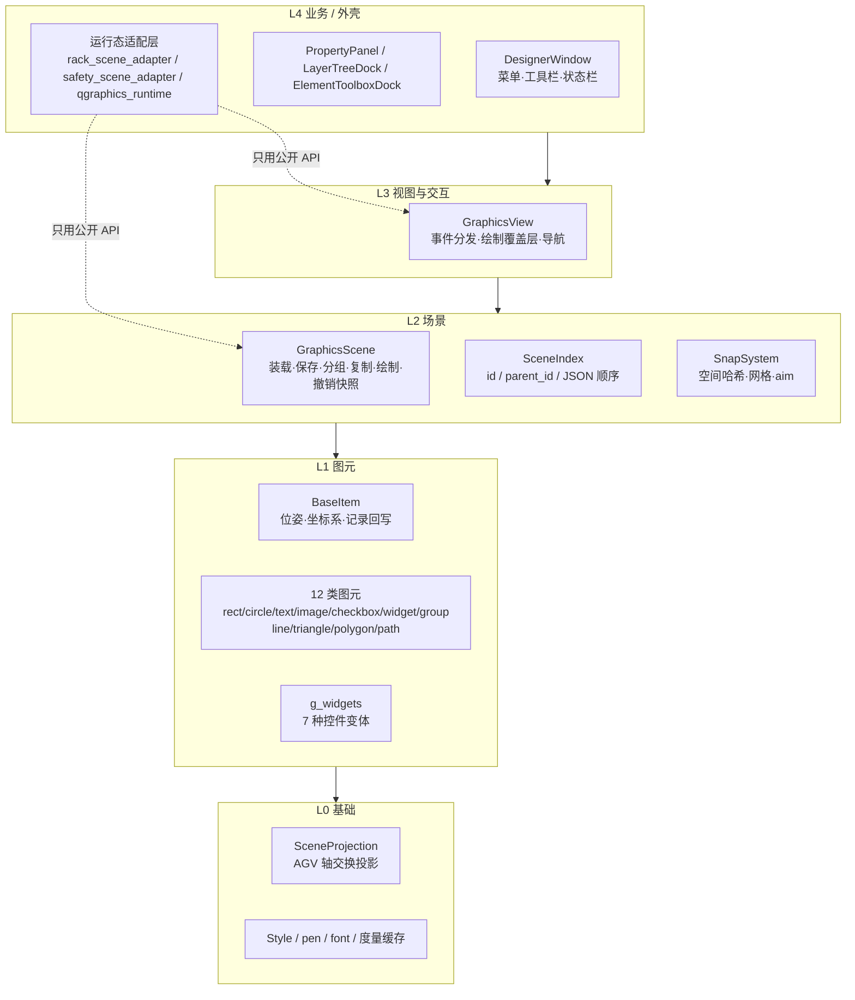
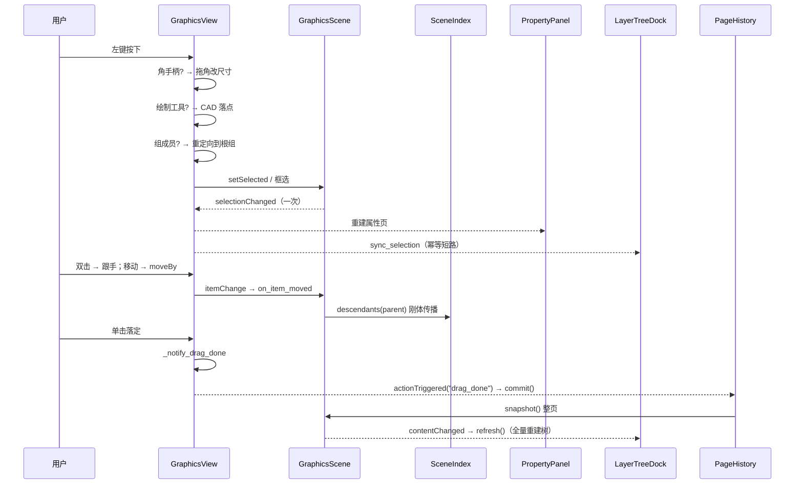

# CoreQGraphics 新场景框架设计文档

> 版本：v1.0（现状基线 + 演进建议）
> 日期：2026-11-09
> 适用代码：`Designer/CoreQGraphics/` 及其运行态适配层（`App_RackConfig`、`App_SafetyCar`、`App_PopPick`）
> 关联文档：`docs/stage2_geometry_backend_design.md`（旧引擎几何后端方案，附录 C 论证了本路线）

---

## 0. 摘要

CoreQGraphics 是把旧 `Designer/Core`（自绘 `QWidget` + `myQuadTreeScene`）整体换成原生 `QGraphicsScene/QGraphicsView` 的**平行实现**，读同一份 `page_*.json`、格式零改动，旧引擎保留可回滚。当前已在**设计器**（`python -m Designer.CoreQGraphics.ui`）和**三条运行态业务线**（料仓、安全车、PopPick）落地。

规模：场景层 6 593 行（含包文档 384 行）+ UI 外壳 2 459 行（共约 9 050 行），配套回归 5 100+ 行、适配层 2 534 行。

**本文档的三个结论：**

1. **架构是健康的**：分层清晰、无环依赖、`page JSON` 双向零漂移、1618 图元逐项几何对拍零差异。硬约束（见 §5）已被回归锁死，可以放心在此之上演进。
2. **当前瓶颈在「编辑命令的端到端成本」，不在渲染**：`page_1`（1618 图元）单条编辑命令约 **170~240 ms**、撤销一步 **314 ms**、按 T 键 **134 ms**。拆开看是「整页快照 + 图层树全量重建 + 吸附点全量重建」三件 O(n) 工作在每次编辑里重复做。
3. **有 12 条缺陷（D-1~D-12）+ 6 条结构性技术债（T-1~T-6）需要收口**（§7）。其中 3 条影响正确性（打开新页误标脏、重载后包装对象悬空、`page_record()` 泄漏内部引用），其余影响可维护性与扩展成本。

优化建议按 **P0（手感/正确性）/ P1（一致性/可维护）/ P2（能力扩展）** 三档给出，每条都带证据、方案与验收口径（§8）。按 P0 全部落地后，`page_1` 的编辑延迟可从 ~200 ms 降到 **50 ms 以内**，撤销从 314 ms 降到 **150 ms 以内**（增量快照 + restore diff 落地后可到 80 ms 以内）。

---

## 1. 定位与边界

### 1.1 为什么要重写

旧 Core 的痛点不是「画得慢」，而是**结构不可维护**：

| 痛点 | 旧 Core 的形态 | 新框架的处置 |
| --- | --- | --- |
| 场景与视图耦合 | 自绘 `QWidget` 同时承担场景、视图、事件分发 | 拆 `QGraphicsScene` + `QGraphicsView`，各司其职 |
| 层级靠手工排序 | `m_sorted_items` + zValue 排序，1573 项 z 值重复（仅 207 个不同值） | Qt 场景图负责绘制顺序，索引只管逻辑关系 |
| 控件承载靠补丁 | `EmbeddedWidgetLayer`：裸 `QWidget` overlay + 位图快照 + 延迟事件派发 | `QGraphicsProxyWidget`（设计态自绘占位，运行态挂真实控件） |
| 命中/框选自写 | `QuadTreeScene` 自己算命中与框选 | Qt `BspTreeIndex` + `RubberBandDrag` |
| 变换手工换算 | 每处 `sceneToView` + `translate` + `rotate(-angle)` | 加载时一次投影进几何，Qt 变换承担旋转 |

### 1.2 目标

- **格式零改动**：`page_*.json` 与旧引擎逐字段同构，未编辑字段 round-trip 逐字节不变（INV-2）。两个设计器可互相打开同一页。
- **几何零差异**：新版 `sceneBoundingRect()` 等于旧 `viewBoundingRect()`；反投影后等于旧 `sceneBoundingRect()`（含旋转后的 AABB）。逐图元一致（INV-1）。
- **可交互**：CAD 式绘制、正交、吸附、双击跟手、拖角改尺寸、组合模板、撤销重做。
- **可嵌入**：作为运行态后端被业务系统包壳使用，不要求业务改代码（只改 import 或加薄适配层）。

### 1.3 非目标（明确不做）

- 不移植 PLC / 料仓状态绑定与站点说明页（属业务层）。
- 不移植旧 `EmbeddedWidgetLayer` 的位图快照 / 延迟事件派发性能补丁（见 D-11，标记为运行态风险）。
- 不做多文档 / 多页签（见 P2-4）。
- 不改页面数据模型（不加字段、不改字段语义）。

---

## 2. 总体架构

### 2.1 分层



依赖方向是单向的，实测无环：

```
g_projection ← g_style ← g_widgets
      ↑           ↑          ↑
   g_element ─────┴──────────┘
      ↑
  g_elements
      ↑
   g_scene ──→ g_snap（仅常量与算法，不反向）
      ↑
   g_view
      ↑
     ui/*
```

`ui/*` 只依赖 `g_*`；`g_*` 绝不 import `ui/*`（`__init__.py` 用 `__getattr__` 延迟导出 UI 类，纯场景用户不会被 Widgets 面板拖慢导入）。

### 2.2 模块职责与规模

| 模块 | 行数 | 职责 | 对外关键 API |
| --- | ---: | --- | --- |
| `g_projection.py` | 98 | 页面坐标 ↔ 视图坐标（AGV 轴交换 + 双轴取反） | `point/rect/size/angle/inverse_*` |
| `g_style.py` | 169 | 画笔/画刷/字体/文字度量，带缓存 | `pen_for/brush_for/font_for/text_metrics` |
| `g_widgets.py` | 323 | 7 种控件变体：字段解析、样式表、真实控件、设计态占位绘制 | `create_control/paint_variant` |
| `g_element.py` | 912 | 图元基类：位姿模型、双坐标系、记录回写、缩放旋转 | `live_page_pose/set_page_*/to_page_record` |
| `g_elements.py` | 1 071 | 12 类图元绘制与几何（顶点类烘焙、文本双向联动） | `ITEM_TYPES` |
| `g_scene.py` | 1 411 | 装载保存、索引、分组、复制粘贴、绘制控制器、widget proxy、撤销快照 | `load_page/save_page/create_item/...` |
| `g_snap.py` | 283 | 捕捉点空间哈希、网格自适应、`aim()` 决策 | `update_points/aim/candidates` |
| `g_view.py` | 1 942 | 全部鼠标键盘交互、绘制覆盖层、导航门控、拖角手柄 | `_snap_action/begin_follow/...` |
| `ui/design_window.py` | 695 | 主窗口装配 + 命令分发 `_do()` | `DesignerWindow` |
| `ui/property_panel.py` | 691 | 分页属性面板（通用/外观/布局/专用/控件/场景/多选） | `update_for_selected` |
| `ui/layer_tree.py` | 194 | 图层树（平铺 / 分组两种模式 + 过滤） | `refresh/sync_selection` |
| `ui/toolbox.py` | 449 | 图元工具箱 + 组合模板按钮 + 缩略图自绘 | `ElementToolboxDock` |
| `ui/template_store.py` | 312 | 组合模板存取（与旧设计器共用一份 JSON） | `TemplateStore.add_from_group` |
| `ui/history.py` | 71 | 整页快照式撤销栈 | `PageHistory.commit/undo/redo` |

### 2.3 一次鼠标点击的数据流



---

## 3. 数据模型

### 3.1 page JSON

顶层三个键：`sceneRect` / `backgroundColor` / `items`。`items` 是**平铺数组**，父子关系只由 `parent_id` 表达。

图元记录（以 `rect` 为例）：

| 字段 | 类型 | 说明 |
| --- | --- | --- |
| `id` / `name` / `type` | int / str / str | 身份与类型（12 类） |
| `parent_id` / `children_ids` / `group_id` | int / list / int | 逻辑层级。**加载时只用 `parent_id`**，`children_ids` / `group_id` 完全不参与建链（旧实现只写不读） |
| `center_pos` / `origin_pos` | `{x,y}` | 页面坐标：可视中心 / 旋转支点 |
| `width` / `height`（`circle` 用 `radius_w/radius_h`，`line` 用 `head_pos`/`end_pos`，顶点类用 `vertices`） | float / list | 几何 |
| `rotate` | float | 页面角度（度） |
| `style` | dict | `stroke/strokeWidth/fill/fill_color/opacity/font_size/cornerRadius` |
| `zValue` | float | 绘制层级；**1573 项重复、仅 207 个不同值**，真实层级靠数组顺序稳定排序 |
| `context` / `image_path` / `checked` / `widgetType` 等 | — | 类型专有字段 |
| `widgetType/widgetText/widgetFontSize/widgetColor/widgetBackground` | — | widget 的 5 个**顶层**字段（不在 `style` 里） |

存量页面实测分布（`page_1.json`，1618 项）：

| 类型 | 数量 | 类型 | 数量 |
| --- | ---: | --- | ---: |
| rect | 1205 | line | 10 |
| circle | 192 | triangle | 4 |
| text | 103 | polygon | 4 |
| group | 96 | image | 2 |
| | | widget | 2 |

结构特征：顶层图元仅 **29** 个，有父图元 1589 个，最大子树 **153** 个，有子节点的父 96 个。这决定了「父移动传播」的成本上限（§6）。

### 3.2 三个坐标系

| 坐标系 | 含义 | 谁在用 |
| --- | --- | --- |
| **page（页面）** | 业务真值，`center_pos` 等字段的单位 | 属性面板、page JSON、`set_page_*` |
| **view（视图/场景）** | Qt 场景坐标，= 页面坐标经 `SceneProjection` 投影 | `QGraphicsItem.setPos`、命中、绘制、吸附 |
| **local（图元局部）** | 以 `mapToScene(0,0)` 为原点的直方框 | `paint()`、`boundingRect()` |

AGV 投影（`SceneProjection.agv=True`，默认）：

```
view.x = -page.y · kx + ox
view.y = -page.x · ky + oy      kx = grid/units_x = 50/200 = 0.25
```

这是**轴交换 + 双轴取反**（det < 0，镜像），所以：

- 页面 `Δy = 0` 在屏幕上是**竖线**，页面 `Δx = 0` 才是横线（正交约束必须先投影再锁轴，见 §4.4）；
- 屏幕向右 = 页面 `y` 减小，屏幕向下 = 页面 `x` 减小（方向键微调的方向换算依据）；
- 视图宽 ↔ 页面高、视图高 ↔ 页面宽（文本量尺寸、`getSize()` 都要走 `inverse_size`）。

### 3.3 平铺层级（关键决策）

**Qt 层不使用 `setParentItem`**，所有图元都是场景根项，逻辑父子只存在于 `SceneIndex`。

理由（代码事实推导）：旧场景按 `zValue` 排序绘制，而 `page_1` 1618 个图元的 z 值只有 **207 个不同取值，1573 项重复**，真实层级由 JSON 数组顺序决定。Qt 的父子关系会把子的 zValue 解释为「父的局部坐标」，整组被拉到同一层，与旧行为不符。

代价：

- 父移动时必须**手工传播**给全部后代（`GraphicsScene.on_item_moved` → `apply_rigid_pose`），成本 O(子树大小)；
- 删除父必须**递归删除**后代（旧 Core 语义，且必须如此，否则成员变孤儿）；
- 复制/粘贴/模板实例化必须**逐点施加偏移**（center/origin/head/end/vertices），只改顶层 pos 不行。

`SceneIndex` 提供四件事：`by_id`、`order`（JSON 顺序，决定层级）、`parent_of/children_of`、`descendants()`。

### 3.4 位姿模型（pos + origin + R）

每个图元由三个量决定屏幕位置：**可视中心 C**、**旋转支点 O**、**角度 θ**。Qt 侧落地为：

```python
# g_element._place()
item.setTransformOriginPoint(o_local)      # o_local = 支点在局部坐标
item.setPos(C_view - o_local)              # 使 mapToScene(0) == C
item.setRotation(θ)
# 等价于： scene(q) = pos + o + R(θ)·(q − o)
```

由此得到两条必须记住的性质：

1. `mapToScene(QPointF(0,0)) == 可视中心`，与支点是否自定义无关 —— 这是 `has_explicit_geometry()` 判定与文本/控件对齐的基础。
2. **平移必须用 `pos()` 而不是 `scenePos()`**：自定义支点时两者恒差 `o − R·o`。同理，改角度只动 `rotation()`，`pos` 不动，于是「支点处不动」天然成立。

有父图元还有第二套读数：**父坐标系**（`page_local_center/angle/origin`）。存储仍是场景绝对坐标，靠 `local_to_world` / `world_to_local` 互换。属性面板的「布局」页在设父后显示的就是父系坐标，中心 X/Y 只读（子图元不能自行平移）。

---

## 4. 核心机制

### 4.1 装载 / 保存 / round-trip

**装载**（`load_data`）：`clear_page()` → 逐记录 `cls(record, projection)` → `addItem`（顺序 = JSON 顺序）→ `index.register` → 最后统一 `rebuild_links()`（JSON 里子 id 常小于父 id，注册时父可能还不在索引里）。

**保存**（`page_data` / `save_page`）：`header` 深拷贝 + `items` 按 `index.order` 逐项 `to_page_record()`。

`to_page_record()` 的双路径是 round-trip 零改动的核心：

```python
if not self._geo_dirty:
    return copy.deepcopy(self._page)     # 没动过几何 → 原样回写
out = copy.deepcopy(self._page)          # 动过 → 重算 center/origin/rotate/z
...
```

`_page` 是**唯一真值**：属性编辑走 `set_page_field()` 直接改 `_page` 并置 `_dirty`，几何编辑另置 `_geo_dirty`。两者分离，避免「改个颜色被当成几何变化」而触发文本重排。

**已知副作用**：`page_data()` 对 1618 项各做一次 `deepcopy`，实测 35~57 ms，是 `history.commit()` 的主要成本（§6、P0-1）。

### 4.2 几何与刚体传播

父图元移动/旋转时，`on_item_moved()` 用「中心 + 角度」描述刚体运动并施加给全部后代：

```
p' = R(Δθ)·(p − C_old) + C_new
```

- 纯平移（Δθ≈0）：还要 `shift_origin_by(dx,dy)`，让支点跟着走（**这是曾经「A 跑偏」bug 的根因，勿删**）；
- 旋转：支点不动，只有中心在动，所以**不能**在此平移支点；
- 顶点类（line/triangle/polygon/path）把旋转**烘焙进 `vertices`**，矩形类直接改 Qt 变换；
- `_syncing` / `_suppress_propagate` / `_suppress_geo` 三层防重入，避免后代被二次传播。

顶点类的角度是「记账」不是「重建」：`_baked_angle` 记录已烘焙的角度，`page_angle() = _baked_angle − rotation()`，存盘时才 `bake_rotation()`。烘焙必须原样带上中心与支点 —— 三角形不是中心对称图形，绕中心转一次后包围盒中心已经换了个点，若按新包围盒重新定位，支点会跳一大截。

### 4.3 交互状态机

视图里有 6 个互斥的交互态，优先级从高到低（`mousePressEvent` / `mouseMoveEvent` 的分支顺序）：

| 优先级 | 状态 | 进入方式 | 退出方式 | 关键约束 |
| ---: | --- | --- | --- | --- |
| 1 | 拖角改尺寸 | 按下四角手柄 | 松开 | 冻结按下瞬间的 `sceneTransform().invert()`，每帧只提交增量 |
| 2 | 平移 | 中键 / 空格+左键 | 松开 | 受 `set_pan_enabled` 门控 |
| 3 | 绘制 | 工具箱/菜单激活 | Esc / 完成 | 与跟手互斥（跟手会抢走 mouseMove 的预览分支） |
| 4 | 跟手（双击） | 双击图元 | 单击落定 / Esc 回原位 | 按**光标增量**移动，不是绝对定位 |
| 5 | 吸附抓手 | 按 T 命中图元点 | Esc / 改选中 / 换工具 | 抓起即跟手，第二次 T = 精修对齐 |
| 6 | 点选 / 框选 | 左键按下空白或图元 | 松开 | 组成员重定向到根组 |

**左键永不拖动图元**（`ItemIsMovable` 恒 False，INV-7）。移动图元只有两个入口：双击跟手、方向键微调。这是刻意的选择 —— 避免点选时手抖把图元挪走，代价是「拖拽移动」这个通用手势要用户重新学。

**T 键是动作键，不是开关**（4 条语义）：
1. 命中图元捕捉点 → 选中该图元 + 进抓手（= 实时跟手），抓起瞬间**不移动**；
2. 抓手期间再按 T → 整体平移 `新点 − 记录点`，被抓点精确落到新点，可连续对齐；
3. 只选中未抓手 → **只移动光标**，图元不动（INV-6）；
4. 绘制工具激活 → 只做取点吸附 + 预览同步，不选不抓不移。

### 4.4 吸附子系统

三层结构：

- **网格**：不枚举，`nearest_grid()` 解析算最近格点。基准步长 `GRID_STEP = 50` 视图单位（= 页面 200 单位），随缩放按 2 的幂细分/合并，保证屏幕格宽落在 18~90 px —— **画出来的格子就是能吸的格子**。
- **图元点**：端点 / 中点存空间哈希（`SnapSystem.update_points`），查询只扫光标附近格子（`_cells_around`），不做全表遍历。
- **决策**：`aim(point, exclude, always)` —— 图元点优先，网格点仅在**严格更近**时顶替；`always=True` 时退到最近格点（保证光标附近永远有一个红十字）。

两条容易被踩的口径：

1. **端点取真实顶点**：矩形类用 `frame_corners()`（包围盒四角，拖角专用），线/三角/多边形/路径用 `_PointBasedItem.snap_points()` 的顶点表。水平线的「细轴加厚 60」会把包围盒推到线外 30 单位，拿包围盒角当捕捉点就会出现「鼠标贴着看得见的端点却没有十字」。
2. **排除按 owner，不按坐标**（INV-10）：`_selection_own_points()` 用 `owners_at()` 查归属，若同一坐标上还有未选中图元的点就保留。按坐标一刀切会导致「被抓图元跟手到目标端点时两点重合，目标点被一起剔掉」。

`_selection_own_points()` 有缓存（全选 1.4 万点、逐帧重算 60 ms），失效点是 `geometryChanged` / `refresh_snap_points` / 换场景。

### 4.5 撤销与脏标记

`PageHistory` 是**整页快照**栈（上限 60 步）：`commit()` 时 `deepcopy(scene.snapshot())`，与栈顶相等则跳过。`undo/redo` → `scene.restore(state)` → `load_data()` 全量重建。

优点：实现简单、语义绝对正确、不受「哪些操作该记一步」影响。
代价：每一步 76~106 ms；撤销一次重建全场景 314 ms，**且选区清空**（§7 D-2）。

脏标记三个来源：`_dirty`（非几何字段）、`_geo_dirty`（几何）、`scene._modified`（页面级）。`on_item_moved` 在纯平移时直接置 `_modified`，因为拖拽不经过 `notify_edit`（否则拖半天关窗不提示保存）。

### 4.6 widget proxy（运行预览）

设计态：`g_widgets.paint_variant` 自绘 7 种占位外观（下拉三角、微调箭头、勾选框…），只画不改几何，对拍与 round-trip 不受影响。

运行态（`set_scene_mode(True)`）：为每个可见 widget 建一个**独立顶层** `QGraphicsProxyWidget`：

- 不做图元的 Qt 子项（否则 `sceneBoundingRect` 被撑大，page_1 对拍立即崩）；
- 不进 `SceneIndex`（`all_items` / `page_data` 都看不到它，INV-8）；
- 对齐方式：控件本地矩形恒 `(0,0,w,h)`，`resize` 只改尺寸，`setTransformOriginPoint(w/2,h/2)` 把旋转支点钉在控件中心，`pos = mapToScene(0,0) − (w/2,h/2)`。**不要用 `setGeometry(-w/2,-h/2,w,h)` 再 `setPos`** —— 前者会同步改写 pos，控件左上角跑到中心并绕左上角转。

### 4.7 运行态适配层

三条业务线都采用「薄包装」而非改业务代码：

| 适配层 | 行数 | 包装目标 | 关键点 |
| --- | ---: | --- | --- |
| `rack_scene_adapter.py` | 580 | 旧 `SceneManager` + `base_element` | 几何一律 page 坐标；`change_position(pos)` 对齐左上角（`delta = pos − tl`） |
| `safety_scene_adapter.py` | 898 | 旧 `QuadTreeScene` + `SceneManager` | 复刻 `m_items`/`m_name_items`/`m_sorted_items`/`findItem`；`Signal(object)` 载荷双形态 |
| `qgraphics_runtime.py` | 1 056 | PopPick 运行态卡片 | `RuntimeView.keyPressEvent` 除空格外全吞（避免设计器快捷键误入运行态） |

适配层的硬规则（都已写进记忆，此处只列结论）：`getSize()` 用 `inverse_size`；四角是解析式 `中心 + R(θ)·(±w/2,±h/2)` 而非 AABB 角；旧 `sceneRect` 固定 ±100000 必须照抄；`isinstance` 对壳失效要用 `_group_like` / `_element_like` 兜底；`resizeEvent` 要钉左上角（否则底部 dock 展开画面整体上移）。

---

## 5. 不变量（评审与重构的红线）

| 编号 | 不变量 | 验证方式 | 破坏后果 |
| --- | --- | --- | --- |
| INV-1 | `page_1`（1618 图元）与旧 Core 逐图元几何零差异 | `tools/verify_core_qgraphics.py` | 业务运行态画面与设计稿不一致 |
| INV-2 | 未编辑字段 round-trip 逐字节零改动 | 同上 + UI 脚本哈希比对 | 两个设计器互相踩踏文件 |
| INV-3 | Qt 层平铺，不使用 `setParentItem` | 代码审查 + 对拍 | 层级全乱、对拍崩 |
| INV-4 | 子图元不可自行平移，但可自行旋转 | `verify_core_qgraphics_ui.py` §6.12 | 组内图元跑偏 |
| INV-5 | 加载 / 撤销重建**绝不**触发文本几何联动 | UI 脚本 round-trip 段 | 存量页面字号被改写 |
| INV-6 | T 键在未抓手时绝不移动图元 | §8.30（10 条） | 按 T 图元乱飞 |
| INV-7 | 左键不拖动图元（`ItemIsMovable` 恒 False） | §8.12 | 点选时误移动 |
| INV-8 | 运行态 proxy 不进索引、不参与保存 | `verify_embedded_widget.py` | 保存多出幽灵图元 |
| INV-9 | 快照 / 撤销不改 `_page_path` 与脏标记 | UI 脚本 | 关窗误提示 / 丢路径 |
| INV-10 | 捕捉点排除按 owner 而非坐标 | §8.27 / §8.28 | 按 T 光标漂到格点 |

**任何重构必须同时跑通这 10 条**。当前回归资产：

| 脚本 | 行数 | 覆盖面 |
| --- | ---: | --- |
| `tools/verify_core_qgraphics.py` | 1 113 | 几何对拍、序列化、复制粘贴、模板、文本、widget |
| `tools/verify_core_qgraphics_ui.py` | 2 615 | 主窗口、属性面板、图层树、命令、撤销、渲染、交互（§8.x 共 30 组） |
| `tools/verify_safety_car_v2.py` | 419 | 安全车适配层（559 图元零差异） |
| `tools/verify_rack_stores_v2.py` | 390 | 料仓适配层 |
| `tools/verify_pop_pick_qgraphics.py` | 575 | PopPick 运行态（已知 68/70，见 D-12） |
| `tools/bench_core_qgraphics.py` | 131 | **本文档的性能基线**（新增） |

回归**必须串行**跑：并行会抢 `build/` 下的临时文件，出现偶发失败。

---

## 6. 性能基线

测量口径：`page_1.json`（1618 图元）、`QT_QPA_PLATFORM=offscreen`、1600×900 视口、每项取 5 次最小值。复现命令：

```
.venv/Scripts/python.exe tools/bench_core_qgraphics.py --markdown
```

| 操作 | 耗时 (ms) | 性质 |
| --- | ---: | --- |
| `load_page`（冷态首次） | 269 | 一次性，可接受 |
| `load_page`（热） | 156 | 切页成本 |
| `page_data` | 35 | 每次快照 |
| `snapshot` | 56 | 每次快照 |
| `deepcopy(snapshot)` | 27 | 每次快照 |
| **`history.commit`** | **76** | **每条编辑命令** |
| **`refresh_snap_points`** | **134** | **按 T / 切工具 / fit** |
| `scene.snap_points` | 42 | 其中点集生成 |
| `snap.update_points` | 57 | 其中哈希重建 |
| **`LayerTreeDock.refresh`** | **44** | **每次 `contentChanged`** |
| `select_all_items` | 48 | 全选（已从 >180 s 优化到此处） |
| `notify_edit`（单选） | 27 | 属性面板每次提交 |
| `moveBy`（最大子树 153） | 6.2 | 每帧拖动 |
| **`restore`（撤销一步）** | **314** | **每次 Ctrl+Z** |

> 同机重复运行波动 ±50%（Python GC 与缓存状态影响），上表是一轮代表性结果，量级可信、单值仅供参考。

### 6.1 热点归因

单条编辑命令的真实链路（`_do` → `_after_edit`）：

```
history.commit()          76 ms   ← page_data 35 + deepcopy 27
layers.refresh()          44 ms   ← tree.clear() + 重建 1618 个 QTreeWidgetItem
_refresh()                ~1 ms
contentChanged 链          44 ms   ← 又一次 tree.refresh（notify_edit 路径）
─────────────────────────────────
合计                      ~170-240 ms
```

**关键观察：这三块都是 O(n) 全量工作，且与「改了什么」无关。** 改一个像素的描边宽度，也要重建整页快照 + 整棵树 + 全部吸附点。

按帧预算看：拖动单个图元 6.2 ms + 绘制，尚在一帧 16.7 ms 内；但任何「提交型」操作都会让界面卡 0.2 s，连续拖旋转 spinbox 会掉到 5 fps 以下。

---

## 7. 现状评估

### 7.1 已达成的部分

- 1618 图元几何对拍零差异、`page_1.json` round-trip 零改动、`toolbox_templates.json` 零改动，三份硬指标全绿。
- 全选从「数分钟卡死」优化到 48 ms（批量选中 + 图层树幂等短路）。
- 组合模板与旧设计器双向互通（旧 `TemplateStore` 能读新写出的模板，逐类型字段集合零差异）。
- 三条运行态业务线已完成切换，旧适配层对拍零差异（安全车 559 图元、映射 max 1.50 px）。

### 7.2 缺陷清单（带证据）

| 编号 | 缺陷 | 证据 | 影响 |
| --- | --- | --- | --- |
| **D-1** | `load_page` / `load_data` 不重置 `_modified` | 实测：先 `set_page_angle` 再 `load_page`，`is_modified()` 仍为 `True` | 打开另一页后标题带 `*`、关窗误提示「未保存」 |
| **D-2** | 撤销后选区清空、视图不动、耗时 314 ms | `restore()` → `load_data()` → `clear_page()` 全量重建 | 撤销体验断裂，用户丢失上下文 |
| **D-3** | `restore/load_data` 后**所有图元 wrapper 悬空**，但无通知 | bench 脚本 `root.moveBy` 在 restore 后抛 `Internal C++ object already deleted` | 适配层 `SceneManager.m_items` 缓存的是包装对象，仅 `rebuild()` 时刷新（rack 仅在构造时 rebuild）→ 重载页面后拿到悬空引用 |
| **D-4** | 框选仍可选中组成员，与「单击只选组」矛盾 | `_group_root_at` 只拦「按下点在 item 上」的点选 | 「只能选组」语义不彻底 |
| **D-5** | `page_record()` 返回内部 `_page` 的可变引用 | `g_element.py:574` `return self._page` | 调用方误改会绕过 `_sync_field` 与脏标记，静默不同步 |
| **D-6** | `LayerTreeDock.set_scene` / `PropertyPanel.set_scene` 不 disconnect 旧场景 | `layer_tree.py:64-69` | 换场景后旧信号仍连着，场景销毁时报 `already deleted`（bench 脚本已复现） |
| **D-7** | 属性面板每次 `valueChanged` 都提交 | `_commit` → `notify_edit`（27 ms）+ `history.commit`（76 ms） | 拖 spinbox 产生几十个撤销步，且每步 0.1 s |
| **D-8** | `template_store.add_from_group` 用树序写 `items` | `_collect_tree_ids` DFS 顺序，与 `_capture_subtree` 的「按 zValue+index.order 排序」不一致 | 「从组存模板」时层级可能偏（复制路径已修，此入口未修） |
| **D-9** | `_apply_snap_follow` / `_apply_snap_to_selection` / `_snap_offset` 无生产调用点 | 全仓 grep 只有定义与注释；回归脚本 5 处直接写 `view._snap_offset` | 死代码带状态，测试还依赖它的字段 |
| **D-10** | 样式缓存满即全清 | `g_style._guard`：`if len > 512: cache.clear()` | 缓存雪崩，绘制期重新构造 QPen/QFont |
| **D-11** | 旧 `EmbeddedWidgetLayer` 的位图快照 / 延迟事件派发未移植 | 已知差异（`__init__.py` 边界说明） | widget 多的页面运行态性能与交互行为未验证；`_set_tree_transparent` 在 proxy 处断链 |
| **D-12** | `verify_pop_pick_qgraphics` 稳定 68/70 | 两项「位图精确覆盖图元」偏差 0.39 px（容差 1e-4） | 回归不能全绿，掩盖真实回归信号 |

### 7.3 结构性技术债

| 编号 | 债务 | 规模 |
| --- | --- | --- |
| T-1 | `g_view.py` 1 942 行，`keyPressEvent` 118 行 if/elif 链、`_do()` 138 行 if/elif 链 | 新增一个快捷键/命令要改两处巨函数 |
| T-2 | 常量散落：`g_view` 顶部 30+ 个模块级常量、`g_elements` 命中带、`g_snap` 阈值，无统一配置与持久化 | 用户无法调网格/吸附手感，改默认值要改代码 |
| T-3 | 模式门控分散：`is_run_mode` 判断散在 pan/zoom/nav/`_group_root_at`/`set_draw_tool`/nudge/右键菜单 8+ 处 | 新增交互极易漏门控（历史上已出过一次） |
| T-4 | 序列化无容错与版本：坏字段（`width: "abc"`）直接抛异常整页打不开；无格式版本号与迁移钩子 | 一个坏字段 = 页面报废 |
| T-5 | 类型靠约定：`_page` 是裸 dict，无 TypedDict/schema，无 mypy 覆盖 | 字段名写错在运行期才炸 |
| T-6 | 测试无框架：自建 `check()` + 单文件 2 615 行，无 pytest、无 CI、无法只跑某一组 | 定位失败要读全量输出 |

---

## 8. 优化建议

优先级定义：**P0** = 用户可感知的卡顿或正确性问题；**P1** = 一致性 / 可维护性；**P2** = 能力扩展。

### 8.1 P0-1：把「整页快照」换成「增量快照」

**问题**：`history.commit()` 76 ms，`restore()` 314 ms，是编辑与撤销的主成本。

**证据**：`page_data` 35 ms 来自 1618 次 `to_page_record()` 的 `deepcopy`；`deepcopy(snapshot)` 再 27 ms；`restore` 走 `load_data` 全量重建。

**方案（三档，可叠加）**：

1. **快照共享（低风险，先做）**：`to_page_record()` 对 `_geo_dirty == False` 的图元返回 `dict(self._page)`（浅拷贝）。已核实全仓**没有** `self._page["style"]["x"] = ...` 形式的嵌套就地写入（34 处 `_page[...]` 全是整体替换），因此浅拷贝足够隔离。预期 `page_data` 35 → ~8 ms。
2. **只存变化（中风险）**：`PageHistory` 改存 `(changed_ids, {id: record})` 增量补丁 + 周期性全量锚点。内存从 60×(整页) 降到接近常数，可把上限提到 500 步。
3. **restore 做 diff（配套 2）**：按 id 比对记录，只删除/重建变化的图元，未变化项保留对象与选中状态 —— 同时解决 D-2 的「选区丢失」。

**验收**：`history.commit` < 15 ms；`restore` < 80 ms；撤销后选区恢复（新增断言：撤销前选中 3 项，撤销后仍选中对应 3 项）。

### 8.2 P0-2：吸附点表改成增量维护

**问题**：`refresh_snap_points()` 133 ms，而它被按 T、切工具、fit、每次 `_snap_action` 开头调用（`_snap_action` 为保证 owners 最新每次都刷）。

**证据**：`scene.snap_points` 42 ms（1618 次 `snap_points()` 生成 14 476 个 QPointF）+ `update_points` 57 ms（重建哈希 + owner 表）。

**方案**：

1. **点缓存**：`BaseItem` 缓存 `(ends, mids)`，`prepareGeometryChange` / 位姿变化时失效。变化一个图元只需重算 1 项（< 0.1 ms）。
2. **按 owner 增量更新**：`SnapSystem` 增加 `update_owner(iid, ends, mids)` / `remove_owner(iid)`，内部维护 `owner → coords` 反向表；哈希桶按坐标就地增删，不整体重建。
3. **拖拽期间冻结**：跟手 / 抓手 / 方向键连续移动期间完全不刷新（现在的 `_finish_nudge` 已经这么做，跟手分支要同样处理）。

**验收**：单图元几何变化后的刷新 < 2 ms；`page_1` 全量首次构建 < 60 ms；按 T 端到端 < 20 ms；INV-10 的 §8.27/§8.28 全绿。

> **实现状态（2026-11-10）：方案第 2 项已落地；第 1 项点缓存、第 3 项拖拽冻结未做。**
>
> - `SnapSystem` 新增 `owner → 条目` 反向表 `_by_owner` 与条目引用表 `_entry_owners`，
>   配套 `update_owner(oid, ends, mids)` / `update_owners()` / `remove_owners()` /
>   `is_incremental`。点集按坐标去重，删除一个 owner 时按引用计数判断是否真删点，
>   共享坐标（page_1 有 27 个多 owner 坐标）不会被误删。
> - `GraphicsScene.snap_points_for(iid)` 提供单图元口径，与全量
>   `snap_points_with_owners()` 完全一致（含可见性判断）。
> - `GraphicsView` 订阅 `itemChanged(ids)` → `refresh_snap_owners(ids)` 立即增量；
>   `structureChanged` 只置 `_snap_full_dirty`，由 `sync_snap_points()` 在按 T / fit /
>   交互收尾时惰性全量。按 T 在表已同步时零成本；绘制中的临时图元仍按老口径全量。
> - 表未建 / 已标脏 / 非带归属表（回归里直接 `update_points(ends, mids)` 的老口径）
>   一律回退全量，保证「增量结果 == 全量结果」。
> - 同进程实测：`refresh_snap_owners(1 项)` **0.04 ms**、`sync_snap_points`
>   **0.00 ms**、单次属性编辑端到端 **1.9~5.7 ms**，对比全量
>   `refresh_snap_points` **87~189 ms**。对拍门禁：
>   `tools/verify_core_qgraphics_incremental.py`（0 失败）。
> - **未做**：点缓存（当前仍对每个变更 owner 调一次 `snap_points()`，但已不是
>   1618 次）、拖拽期间冻结、`page_1` 全量首次构建 < 60 ms（仍 ~87 ms，属
>   `snap.update_points` 全表重建，需 P0-1 的快照思路外推到点表）。

### 8.3 P0-3：拆分 `contentChanged`，图层树增量刷新

**问题**：`LayerTreeDock.refresh()` 每次 `contentChanged` 都 `tree.clear()` + 重建 1618 节点（16~44 ms），并且丢失展开/滚动位置。

**证据**：`notify_edit`（单选）27 ms 中，约 16 ms 来自它触发的 `contentChanged` → `LayerTreeDock.refresh()`（全量重建，实测 16~44 ms 视负载波动）；`_after_edit` 又显式调一次 `layers.refresh()`，等于一次编辑重建两遍树。

**方案**：

1. 拆信号：`structureChanged`（增删/父子/改名/可见性）→ 全量或子树重建；`itemChanged(ids)`（属性）→ 只更新对应行的文本与颜色。
2. 全量重建时保存/恢复「展开集合 + 滚动位置」。
3. `_after_edit` 里去掉重复的 `layers.refresh()`（`contentChanged` 已经触发过一次）。

**验收**：改单个图元颜色时树刷新 < 2 ms；展开状态在编辑后保持不变。

> **实现状态（2026-11-10）：方案第 1、3 项已落地；第 2 项（展开/滚动位置保存）未做。**
>
> - `GraphicsScene` 新增 `structureChanged = Signal()` 与
>   `itemChanged = Signal(object)`（载荷 `list[int]`）；粗信号 `contentChanged`
>   **保留并照常发射**，供状态栏一类与具体图元无关的订阅者使用，避免破坏
>   外部/回归的兼容口径。所有写操作统一走
>   `emit_structure_changed()` / `emit_items_changed(ids)` 两个出口。
> - 分类：`create_item` / `delete_items` / 成组解组 / 复制粘贴 / `_finish_draw` /
>   `set_item_z` / `restore` / `load_page` → 结构；`notify_edit` / 对齐分布 /
>   旋转支点 → 按 ids。空 ids（页面级改动如背景色）只发粗信号，不惊动树与点表。
> - `LayerTreeDock` 改订阅细信号：`update_items(ids)` 只重画对应行的文本与
>   显隐灰字；有过滤 / 新增 / 删除 id / 树未建时安全退化到全量 `refresh()`。
>   `set_scene` 改为按 `_bound` 记录实际连接并解绑（顺带修 D-6，消除 PySide6
>   的 disconnect RuntimeWarning）。
> - `_after_edit()` 简化为只 `history.commit()`，去掉了重复的 `layers.refresh()`
>   与 `_refresh()`：刷新已由写操作当下的广播完成，`history.changed` 负责按钮态。
> - 同进程实测：`LayerTreeDock.update_items(1 行)` **1.77 ms** vs 全量
>   `refresh()` **14.52 ms**。对拍门禁见
>   `tools/verify_core_qgraphics_incremental.py`（含行文本 / 灰字与全量一致、
>   换场景解绑等断言）。
> - **未做**：全量重建时保存/恢复展开集合与滚动位置（本次改成尽量不走全量，
>   结构变化仍会重建）。

### 8.4 P0-4：修 D-1（打开新页误标脏）

`load_data()` 末尾不重置 `_modified`，`_open_page` 也不 `mark_saved()`。最小修复：`load_page()` 成功后 `_modified = False`（`restore()` 仍保留 `was_modified` 语义，不受影响）。

**验收**：改一页 → 打开另一页 → 标题无 `*`、关窗不提示。

### 8.5 P0-5：修 D-3（重载后包装对象悬空）

**问题**：`load_data` / `restore` 会销毁全部图元，外部持有的包装对象全部悬空；适配层靠调用方记得 `rebuild()`（rack 只在构造时 rebuild）。

**方案**：新增场景信号 `pageReloaded = Signal()`，在 `load_data` 末尾、`clear_page` 之后发一次；三个适配层的 `SceneManager` 连它自动 `rebuild()`。同时把 `restore()` 的文档补上「所有 item 引用失效」的契约说明。

**验收**：`restore` 后适配层 `find_item(id)` 返回有效包装对象；新增回归：load → 取包装对象 → restore → 再取 → 不抛异常且几何正确。

### 8.6 P0-6：属性面板提交粒度（D-7）

**问题**：QSpinBox/QDoubleSpinBox 的 `valueChanged` 每次按键、每次滚轮都 `_commit` → `notify_edit` + `history.commit`，一次拖动旋转产生几十个撤销步。

**方案**：`setKeyboardTracking(False)` + 用 `editingFinished` / 拖动结束（`sliderReleased`）提交；或对同一 item 同一字段的连续提交做 300 ms 合并（只保留最后一态进撤销栈）。

**验收**：拖 90° 旋转只产生 1 个撤销步；提交间隔内无 >50 ms 卡顿。

### 8.7 P0-7：框选语义与单击统一（D-4）

`mouseReleaseEvent` 里框选结束后，对选中集合做一次根组归一（与 `_group_root_at` 同一策略）：把成员替换为其根组、去重。若产品希望「框选可以进组」，则反过来把单击也放开 —— **需要先定策略，二选一，不能两套并存**。

### 8.8 P1-1：命令与交互的拆包（T-1）

**现状**：`keyPressEvent`（118 行 if/elif）与 `_do()`（138 行 if/elif）是两块「巨型分发表」，两者还有隐式耦合（键盘发 `actionTriggered` 字符串，主窗口再解释）。

**方案（分两步，中间态可发布）**：

```python
# 第一步：把 keyPressEvent 的分支变成表
KEYMAP = {
    (Qt.Key_T, 0): "snap_action",
    (Qt.Key_G, 0): "group",
    (Qt.Key_Delete, 0): "delete",
    (Qt.Key_S, Qt.ControlModifier): "save",
    ...
}
# _do() 同理：COMMANDS = {"group": self._cmd_group, ...}
```

第二步再把交互子系统拆成 `interaction/`（`follow.py` / `resize.py` / `draw.py` / `snap_action.py` / `nudge.py`），`GraphicsView` 只保留编排与覆盖层绘制。

**约束**：回归脚本大量直接访问 `view._follow_items`、`_snap_offset`、`_nudge_keys` 等私有属性 —— 拆分时用属性代理（`@property` 转发到子系统）保持兼容，**不要一次性改测试**。

### 8.9 P1-2：清理死代码，但先迁移测试（D-9）

`_apply_snap_follow` / `_apply_snap_to_selection` 无生产调用点，但 `_snap_offset` 被 5 处回归直接复位。顺序必须是：

1. 新增 `view.reset_snap_state()`（清 `_snap_offset` + 抓手状态）；
2. 回归里的 `view._snap_offset = QPointF(0,0)` 换成该方法；
3. 删除三个死方法与 `_snap_offset`；
4. 同步删 `__init__.py` 里对应的说明段（否则文档与代码再次分叉）。

### 8.10 P1-3：`page_record()` 收回内部引用（D-5）

改成返回只读视图（`MappingProxyType` 只能保护顶层，嵌套 dict 仍可变）或直接返回 `to_page_record()` 深拷贝。折中方案：保留 `page_record()` 但文档标注「只读，勿改」，内部调用点改用 `self._page`（显式），外部（模板、属性面板）改用 `to_page_record()` 或专门的 getter（`style_value()` 已有）。

### 8.11 P1-4：信号生命周期（D-6）

`set_scene()` 里先 `disconnect` 旧场景的三个信号，再连新场景。`DesignerWindow` 关闭时也应 `view.setScene(None)` / `layers.set_scene(None)`，避免场景先于 dock 析构。

### 8.12 P1-5：样式缓存改 LRU（D-10）

`_guard()` 满 512 就 `clear()` → 下一次绘制全部 miss。改成 `collections.OrderedDict` + `move_to_end` + `popitem(last=False)`，或按「最近使用代数」分两桶轮换。改动局部，风险极低。

### 8.13 P1-6：序列化容错与格式版本（T-4）

1. 逐记录 `try/except`：坏记录跳过并计数，`load_data` 返回 `(loaded, skipped)`，UI 用状态栏提示「3 条记录无法解析，已跳过」。
2. 读取侧版本推断：`fmt = int(header.get("formatVersion", 1))` + `MIGRATIONS = {1: ..., 2: ...}`。**写入侧不主动加字段**（否则 round-trip 零改动失效），只在真正需要迁移时才落版本号。

### 8.14 P1-7：配置外置（T-2、T-3）

新建 `ViewSettings`（dataclass）+ QSettings 持久化：网格步长、吸附阈值、手柄大小、显示项（IDS/中心点/网格）、正交默认值。同时把 `is_run_mode` 的分散判断收敛为 `InteractionPolicy`：

```python
class InteractionPolicy:
    def __init__(self, scene): self.scene = scene
    @property
    def can_draw(self): return not self.scene.is_run_mode
    @property
    def can_nudge(self): return not self.scene.is_run_mode and not self.following ...
```

新增交互时只问策略，不再散写 `if run: return`，从机制上消除漏门控。

### 8.15 P1-8：模板捕获的 z 顺序收口（D-8）

`template_store._collect_tree_ids` 改成与 `_capture_subtree` 一致的 `(zValue, index.order)` 排序后再生成 `items`；同时补一条回归：组内 z 乱序 → 存模板 → 实例化 → 层级与源组一致。

### 8.16 P2 级建议（能力扩展）

| 编号 | 建议 | 价值 | 备注 |
| --- | --- | --- | --- |
| P2-1 | **图元类型注册表**：把 `ITEM_TYPES` / `TYPE_LABELS` / `DEFAULT_SIZES` / `create_item` 分支 / 属性页工厂 / 工具箱图标收进 `ElementSpec` | 新增一种图元从「改 5 个文件」变成「注册一条」 | 当前新增类型的摩擦是最大的扩展瓶颈 |
| P2-2 | **拖动智能参考线**：拖动/跟手时显示对齐线与等距提示（现在只有事后 `align_selected` 命令） | 对齐效率 | 需要 `SnapSystem` 扩展「同 x/y 的边」查询 |
| P2-3 | **导出 PNG/SVG/PDF**：`GraphicsScene.render()` 已具备能力，缺 UI 与选项（含/不含背景、仅选中、2×） | 交付物 | 低风险 |
| P2-4 | **多文档 / 页签 + 跨页复制** | 多页协同 | 需要把「剪贴板」从 scene 提到应用级 |
| P2-5 | **自动保存 / 崩溃恢复**（`.autosave` + 启动检测） | 数据安全 | 与 D-1 的脏标记一起做更顺 |
| P2-6 | **撤销步骤命名**（`commit(label)`，状态栏显示「撤销：移动图元」） | 可发现性 | 依赖 P0-1 的增量快照 |
| P2-7 | **运行态 widget 承载补齐**（位图快照 / 事件派发 / `_set_tree_transparent` 断链） | D-11 收口 | 需先量化 widget 密集页面的运行态帧率 |
| P2-8 | **测试工程化**：pytest + 分层（geometry / json / interaction / ui）+ `--only §8.x` 选择器 + CI 串行 | 定位成本 | 现单文件 2 615 行，改一行要跑全量 |

---

## 9. 演进路线

| 阶段 | 内容 | 出口标准 |
| --- | --- | --- |
| **S1 手感修复**（1~2 周） | P0-1（档 1）、P0-2、P0-3、P0-4、P0-6、P0-7 | `page_1` 编辑 < 50 ms、撤销 < 150 ms、按 T < 30 ms；INV 1-10 全绿；三套业务回归零差异 |
| **S2 契约与结构**（2~3 周） | P0-5、P0-1（档 2/3）、P1-1 ~ P1-8 | 撤销 500 步、撤销保留选区；信号生命周期完整；命令表上线且回归零改动 |
| **S3 能力扩展**（按需） | P2-1 注册表 → P2-2 参考线 → P2-3 导出 → P2-4 多文档 | 新增一种图元只改 1 个文件 + 1 条注册 |

每阶段结束都必须做一次「对外契约复核」：适配层只用公开 API、`page_*.json` round-trip 零改动、旧 Core 仍可回滚。

---

## 10. 回归与质量门禁

**必跑（串行）**：

```bash
.venv/Scripts/python.exe tools/verify_core_qgraphics.py        # 几何/序列化对拍
.venv/Scripts/python.exe tools/verify_core_qgraphics_ui.py     # UI/交互全量
.venv/Scripts/python.exe tools/verify_safety_car_v2.py
.venv/Scripts/python.exe tools/verify_rack_stores_v2.py
.venv/Scripts/python.exe tools/verify_embedded_widget.py
.venv/Scripts/python.exe tools/verify_pop_pick_qgraphics.py    # 已知 68/70
.venv/Scripts/python.exe tools/bench_core_qgraphics.py         # 性能基线
```

**门禁规则（建议）**：

1. 前两个脚本必须「失败 0 项」，且 `page_1.json` / `toolbox_templates.json` 哈希不变。
2. `bench` 的关键项超过基线 1.5 倍即视为回归（`commit` / `refresh_snap_points` / `notify_edit` / `restore`）。
3. 新增/修改交互必须补一条 §8.x 断言，且断言里**不**直接写私有状态（用公开查询或测试辅助方法）。
4. 修 D-12：把位图覆盖容差从 1e-4 调整到实际可达值（并记录偏差来源），让最后 2 项变绿 —— 否则回归长期黄灯会让人忽略真实失败。

---

## 11. 风险登记

| 编号 | 风险 | 概率 | 影响 | 缓解 |
| --- | --- | --- | --- | --- |
| R-1 | 增量快照引入「历史状态被后续编辑污染」（共享 dict 被就地改） | 中 | 撤销到错误状态 | 严格 copy-on-write：`set_page_field` 写前确认 `_page` 未被快照引用，或快照侧统一浅拷贝 + 禁止嵌套就地写（加断言） |
| R-2 | 吸附点增量更新漏失效，导致「吸到已经移动的点」 | 中 | 吸附错位 | 失效统一挂 `prepareGeometryChange` / `geometryChanged`；补断点检查（调试模式下每 N 次操作做一次全量比对） |
| R-3 | 重构 `g_view` 时回归脚本大面积红 | 高 | 进度失控 | 保留私有属性代理，测试分两步改；先做命令表（纯增），再拆交互 |
| R-4 | `restore` diff 时 id 复用导致张冠李戴 | 低 | 图元错乱 | 以 `(id, type)` 为键；id 分配器不回退（`_next_id` 单调） |
| R-5 | 运行态 widget 密集页面性能未验 | 中 | 现场卡顿 | S2 前先做一次 widget×N 的帧率基准 |
| R-6 | 旧 Core 与新框架双写同一 JSON 的并发风险 | 低 | 文件覆盖 | 原子写（tmp + `os.replace`，模板已如此）+ 打开时 mtime 校验 |

---

## 附录 A：文件清单

```
Designer/CoreQGraphics/
├── __init__.py            384   包文档（口径大全）+ 延迟导出
├── __main__.py             48   python -m 入口
├── g_projection.py         98   投影
├── g_style.py             169   画笔/字体/度量缓存
├── g_widgets.py           323   控件变体
├── g_element.py           912   图元基类
├── g_elements.py        1 071   12 类图元
├── g_scene.py           1 411   场景/索引/序列化/绘制/widget proxy
├── g_snap.py              283   吸附
├── g_view.py            1 942   视图与交互
└── ui/                  2 459   设计器外壳（主窗口/属性/图层/工具箱/模板/撤销）

tools/
├── bench_core_qgraphics.py  131 性能基线（本文档数据来源）
├── verify_core_qgraphics.py       1 113
├── verify_core_qgraphics_ui.py    2 615
└── ...

App_RackConfig/run/rack_scene_adapter.py    580
App_SafetyCar/safety_scene_adapter.py       898
App_PopPick/qgraphics_runtime.py          1 056
```

## 附录 B：术语表

| 术语 | 含义 |
| --- | --- |
| 页面坐标 / page | 业务真值坐标系，`page_*.json` 字段单位 |
| 视图坐标 / view | Qt 场景坐标，= page 经 AGV 投影后的结果 |
| 平铺层级 | 所有图元在 Qt 层互为兄弟，父子只存在于 `SceneIndex` |
| 支点 / origin | 旋转中心，可与可视中心解耦（默认重合） |
| 烘焙 | 顶点类图元把旋转折进 `vertices` 并记录 `_baked_angle` |
| 跟手 | 双击后图元随光标增量移动的临时状态 |
| 抓手 | 按 T 抓起图元进入的吸附-对齐状态（= 跟手 + 锚点记录） |
| 组合模板 | 存进工具箱、可重复实例化的组（与旧设计器共用 JSON） |
| 门控 | 运行态/绘制态下对某类交互的整体开关 |
