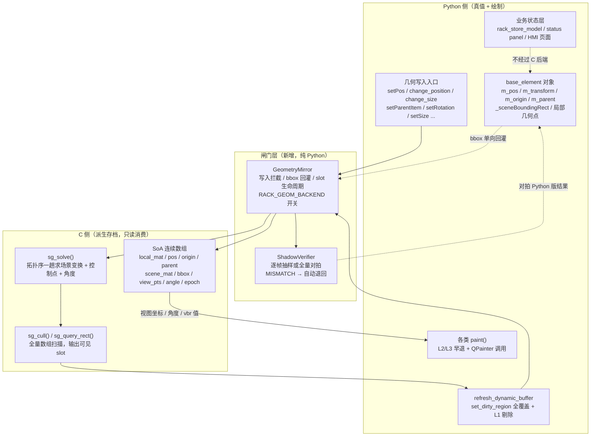

# Stage 2：只读几何数据后端设计方案（评审稿）

| 项 | 内容 |
|---|---|
| 版本 | v1.0 / 2026-11-07 |
| 状态 | 待评审，未实施 |
| 前置 | Stage 0 已完成（`Designer/Core/scene_fast.py`），实测数据见 `build/bench_stage0_ab.json` |
| 范围 | 设计器 / 运行态共用的场景几何求解、可见性剔除、交互空间查询 |
| 不在范围 | 业务状态层、图元 `paint()` 的类型特有逻辑、光栅化、Qt 渲染框架迁移 |
| 量化基线 | `page_1.json`，1619 图元（`m_sorted_items` 1618），1440×900 离屏，`.venv` CPython 3.12.10 / PySide6 6.10.2 |

> 本文中的 C 结构体与函数声明是**接口契约**，不是实现代码。行号基于当前工作树，可能随后续提交漂移。

---

## 0. 评审摘要

**建议结论：批准 P0（影子层）+ P1（变换/剔除接管）+ P2（交互索引接管），暂缓 P3（批量绘制）。**

上一轮口头方案里给 Stage 2 的预期是「整屏 15 ms → 5~6 ms」。本轮把代码事实和实测数据对齐后，**这个口径必须修正**，修正点有三条，都是评审前必须知道的：

1. **5~6 ms 达不到。** 只读几何后端能确定性拿到的收益约 1.2 ms/帧，加上变换链批量化的推算收益共约 2.7~4.7 ms，帧时间落在 **6.5~8.5 ms**（推算，需 P0 校准）。剩下的是逐图元 `QPainter` 调用与光栅化，只有把整段绘制循环搬进 C++ 才动得了。
2. **四叉树不能用来做可见性剔除。** `myGraphicsScene.py:1534-1549` 的注释明确写了「不能走四叉树：运行态图元会随数据刷新移动/改尺寸，四叉树里的记录并不总是最新的」。原方案里「C 侧吐可见 id 列表」如果由空间索引产生，会直接违反这条现有约束并导致图元凭空消失。本方案改为：**C 侧对全量 bbox 数组做一次线性扫描**（1618×4 个 double，估 <0.05 ms），四叉树只服务交互查询。
3. **「状态层是唯一真值」与当前工作树不符。** 项目约定里记录的 `rack_stores_status_model.py`（纯数据真值层）**在当前工作树中已被删除**（`commit 14a377d`），只留下 `App_RackConfig/run/__init__.py:34-52` 里 6 个悬空的 `__all__` 名字。当前真值实际散落在图元对象自身（`_head_pos` / `scene_size` / `_path` / `m_transform` / `_sceneBoundingRect`）。这意味着 Stage 2 的「C 数组是派生存档、Python 对象才是真值」这一单向关系**必须靠显式失效协议保证，不能靠分层隔离天然成立**，风险等级比原估计高。

**需要评审拍板的三个决策点**（详见 §12）：D1 是否含批量绘制（建议不含）、D2 C 边界形态（建议纯 C DLL + ctypes）、D3 bbox 是否搬 C（建议不搬）。

---

## 1. 现状事实与量化基线

### 1.1 Stage 0 之后实测（同进程交错 A/B，`build/bench_stage0_ab.json`）

| 指标 | FAST=0（旧） | FAST=1（现网） | 说明 |
|---|---:|---:|---|
| `on_mouse_move` | 2.868 ms | **1.222 ms** | 每次移动，100 次取 min |
| `frame_full`（一帧 `refresh_dynamic_buffer`） | 13.132 ms | **11.193 ms** | 全屏 `QRegion` |
| `bookkeeping`（paint 被 stub） | 1.308 ms | 1.310 ms | 帧级簿记，与开关无关 |
| `bbox_loop`（剔除循环） | 1.077 ms | 1.069 ms | 全量 bbox 扫描 |
| `paint_net`（派生 = frame − bookkeeping） | 11.823 ms | **9.882 ms** | 逐图元 paint |
| `raster_floor`（1205 矩形一次 `drawRects`） | 4.153 ms | 4.157 ms | 光栅化地板，对照组 |
| `raster_per_item_pen`（逐项 new QPen + drawRect） | 8.284 ms | 8.435 ms | 逐项提交成本，对照组 |
| `transform_walk`（1619 图元各一次 `sceneTransform().map()`） | 5.938 ms | 5.921 ms | ≈ 3.66 µs/图元 |
| `find_children` | — | 0.180 ms | 20 次取 min |

### 1.2 本轮补充实测（临时探针，跑完已删）

图元类型分布（1618 项）：`rect_element` 1205、`circle_element` 192、`text_element` 103、`group_element` 96、`line_element` 10、`polygon/triangle` 各 4、`widget/image` 各 2。即 **74% 是矩形，10 类 paint 中 1 类占绝对多数**。

一帧全屏重绘的调用计数（`sys.setprofile` 统计 `call` + `c_call`）：

| 调用 | 次数/帧 | 归属 |
|---|---:|---|
| 总调用数 | **44 165** | — |
| `QPointF.x()` / `.y()` | 各 5 561 | Python→C++ 取值 |
| `sceneTransform()` / `itemTransform()` | 各 **3 705** | Python 变换链（含父链递归） |
| `QRectF.isNull()` / `.intersects()` | 3 236 / 1 961 | 剔除 |
| `set_dirty_region()` / `sceneBoundingRect()` | 各 **1 618** | 对全量图元无条件调用 |
| `paint`（含 super 链） | 834 | 实际进入绘制的图元 417 |
| `setPen` / `save` / `restore` / `translate` | 407 / 407 / 407 / 376 | QPainter 逐项状态切换 |
| `mapToScene` / `sceneToView` | 各 503 | 逐点视图换算 |

**L1 剔除的实际命中率**（现有全量 `sceneBoundingRect()` 循环）：

| 重绘区域 | 可见图元 | 占比 |
|---|---:|---:|
| 全屏 1440×900 | 417 / 1618 | 25.8% |
| 400×300 | 60 / 1618 | 3.7% |
| 200×200 | 34 / 1618 | 2.1% |
| 50×50 | 14 / 1618 | 0.9% |

即：**全屏时已有 74% 图元被剔除，真正花费的是 417 个图元内部平均 9 次变换链调用 + 407 次 QPainter 状态切换**，不是「遍历 1618 个对象」。把四叉树换成 C 版对帧时间几乎没有帮助，这也是修正收益口径的主要依据。

四叉树 vs 全量扫描（探针口径，全量扫描含两次 `sceneBoundingRect()`，偏悲观）：

| 区域 | quadtree query | 全量 Python 扫描 | `bbox_loop_ms` 基准 |
|---|---:|---:|---:|
| 全屏 | 0.456 ms | 1.985 ms | 1.069 ms |
| 200×200 | 0.161 ms | 2.264 ms | 1.069 ms |

C 侧对 `double[4]×1618` 做同样判断，估 **< 0.05 ms**（约 6.5k 次比较，L2 驻留）。这一项是唯一可以精确定价的帧收益。

### 1.3 收益上限重算

| 环节 | 当前 | C 化后 | 性质 | 依据 |
|---|---:|---:|---|---|
| bbox 剔除循环 | 1.069 ms | < 0.05 ms | **实测可定** | 探针 + `bbox_loop_ms` |
| `set_dirty_region` × 1618 | ≈ 0.2 ms | ≈ 0（C 侧批量写 flags） | 推算 | `bookkeeping_ms` 1.310 ms 的构成 |
| 变换链 3 705 + 3 705 次 | ≈ 3.5~4.5 ms | ≈ 0.15 ms（1618×9 乘加） | **推算，需 P0 校准** | `transform_walk` 3.66 µs/项，缓存命中率未知 |
| `mapToScene` / `sceneToView` 各 503 | 含在上行 | 含在上行 | 推算 | 批量点映射 |
| `setPen`/`save`/`restore`/`translate` 407 组 | ≈ 3~4 ms | 不变 | **只读后端不覆盖** | `raster_per_item_pen` 8.4 ms/1205 项 |
| 光栅化（417 可见项） | ≈ 1.5~2 ms | 不变 | 换渲染器才动 | `raster_floor` 4.16 ms/1205 项按比例 |
| **整帧** | **11.19 ms** | **6.5~8.5 ms** | 推算 | — |
| `on_mouse_move` | 1.222 ms | 0.2~0.4 ms | 推算 | 端点批量映射 + C 索引 |
| `load_element_info` | 526 ms | 不承诺 | — | 加载主要耗在 `from_dict`/`emit`，非纯几何 |

**结论：只读几何后端把帧时间压到 6.5~8.5 ms 区间；要逼近 4~5 ms 必须做 P3（整段绘制循环进 C++）或路线 C（原生 `QGraphicsScene` / C++ HMI）。** 上表标注「推算」的三行是 P0 阶段必须用分段计时校准的目标，不是承诺值。

---

## 2. 三条会改变设计边界的代码事实

### 2.1 可见性判断有明确禁区

`myGraphicsScene.py:1534-1549` `_scene_rect_for_region()` 的 docstring 明确禁止用四叉树判断可见性；`refresh_dynamic_buffer` 当前也是**全量遍历 `m_sorted_items`** + `sceneBoundingRect().intersects(scene_rect)`，不走 `items_in_area()`。

约束（必须逐层保留，不能合并成一次 C 查询）：

- **L1** `refresh_dynamic_buffer:1586-1591`：`scene_rect.isNull()` 或 `bound.isNull()` 时**不剔除**；`scene_rect` 由 `boundingRect()` 合并、`+1` 像素、`normalized()`、固定 40 px 外扩生成。
- **L2** 各 `paint` 开头 `m_veiw_dirty_region.intersects(viewBoundingRect().toRect())`（`elements.py:405/947/1180/1911/1970/3279/3749/4249/4677`）。**`circle_element.paint:2670` 与 `group_element.paint:2306` 没有这一层**。
- **L3** `get_visibility()==False`、`_head_pos is None`、`_path.isEmpty()` 等早退；其中一部分**跳过 `base_element.paint` 记账**，会连带影响 `m_this_frame_flag*` 复位与下一帧脏区信号。
- **`set_dirty_region` 必须对全部 `m_sorted_items` 调用**（`myGraphicsScene.py:1583` 注释说明漏掉会让图元永久不显示），即使 L1 跳过。

因此 C 侧输出的「可见 slot 列表」**只能替代 L1 的循环体**，L2/L3 与各早退分支必须原样留在 Python paint 里。

### 2.2 「单一真值层」当前不存在

- `App_RackConfig/run/__init__.py:34,48-52` 导出的 `RackStoreStatusModel` / `status_delta` / `status_fields` / `visual_key` / `copy_status` / `empty_status` **无定义、无使用点**，来自已删除的 `myDesigner/rack_stores_status_model.py`（`commit 14a377d`）。
- 当前真值散在 `App_RackConfig/run/rack_store_model.py` 的 `RackSlotStatus`（`:637`）、`RackSlot.parts`（`:880`）以及图元对象自身的几何字段上。
- `RackStoresWindow.refresh_models()`（`rack_stores_widget.py:371`）**全库无调用者**，是死代码；`HmiPagesHost.refit_cards()`（`App_PopPick/hmi/binding.py:377`）、`QuadTreeScene.initialize_event_handlers()`（`:904`）同样无调用者。

影响：Stage 2 不能假定「C 数组与状态层天然隔离」。**几何本身就是真值的一部分**，失效协议（§6）是本方案成败的关键，而不是附属细节。另外这也提示一个独立的技术债项，建议单独立项，不要塞进 Stage 2 一并处理。

### 2.3 其它硬约束

| 约束 | 位置 | 后果 |
|---|---|---|
| `m_sorted_items` 是 `sorted(m_items.values(), key=zValue)` 的**稳定全序** | `myQuadTreeScene.py:2319-2326` | C 侧必须能还原「相等 Z 保留插入顺序」，不能只输出 zValue 数值序；`App_PopPick/page_deck.py:501-507` 明确依赖它当设计文件叠放顺序 |
| `items_in_area()` 返回 `set`，吸附点也是 `set` | `myQuadTreeScene.py:1135-1140`、`mySnapSystem.py:98-104` | `snap_to_point` 用严格 `<`（`:311`），等距时的胜出者依赖 set 迭代顺序；C 输出有序列表会改变 tie-break |
| 点选 / 运行态 topmost 命中用 `reversed(m_sorted_items)` | `myGraphicsScene.py:1958`、`myQuadTreeScene.py:949/987` | 必须保留全序的逆序语义，且不用四叉树 |
| `sceneBoundingRect()` / `pos()` / `transform()` / `getSize()` / `path()` 返回**引用** | `element.py:1332,369,414`；`elements.py:350,906,2535,3073,3734,4595` | 外部 `App_*` 直接持有对象与列表；C 后端不得替换这些容器 |
| `_sceneBoundingRect` 用**整体替换**更新，7 处 `update_boundingRect` 全是 `= QRectF(...)` | `elements.py:72/677/2430/2989/3548/4126/4602` | `viewBoundingRect()` 的失效判据是 `_vbr_rect is rect` 对象身份（`element.py:1419`）；C 侧若原地写 4 个 double，该缓存会静默失效 |
| `mapToScene()` / `map_scene_points()` 有 `__is_moving` 副作用 | `element.py:700,711` | `check_hover()` 依赖；批量路径不能省的副作用 |
| `base_element.paint` 末尾 `__check_position_change()` 会**惰性重算 bbox** 并 emit | `element.py:1450-1453` | paint 是 bbox 的兜底写入路径，C 侧无法预测 |
| `Transform.m` 是嵌套 `list[list[float]]`，行主序，`__init__(matrix)` **共享外部引用** | `my_transform_v2.py:26-38` | `get_rotation_angle()` 缓存键是 `id(self.m)`；原地改 9 个元素不会触发失效 |
| `checkbox_element` / `widget_element` 因 MRO 走两遍 `rect_element.paint` | `elements.py:1240/1960` | 每图元「恰好一次变换」的假设不成立，静态调用次数是 2 倍 |
| 无图元覆写任何几何 getter | `elements.py` 全文 | 可以在 `base_element` 单点接管，这是本方案最大的有利条件 |

---

## 3. 目标与非目标

**目标**

- G1 把每帧 3 705 + 3 705 次 Python 变换链、503 次逐点视图换算收敛为 C 侧一次拓扑序求解，Python paint 从数组槽位读预计算好的视图坐标 / 角度 / 包围盒。
- G2 把 1 618 次 bbox 相交判断收敛为 C 侧一次连续数组扫描。
- G3 把 `on_mouse_move` 的端点收集与矩形查询收到 C 侧，`items_in_area` / 框选共享同一索引。
- G4 全程保留 `RACK_GEOM_BACKEND=0` 一键回滚到 Stage 0 路径；影子模式可长期在测试环境开着做在线对拍。

**非目标**

- 不改任何业务状态语义（§2.2 的禁区清单，附录 B）。
- 不把 10 类 `paint()` 的类型特有逻辑搬进 C（文本度量、QPainterPath 顶点、图片、控件承载层全部留 Python）。
- 不替换 `m_items` / `m_sorted_items` / `m_name_items` 容器，不替换 `findItem` 返回的对象语义。
- 不改序列化格式与 `page_*.json`。
- 不引入 numpy（`Stage 0` 已实测在 5~620 点规模比纯 Python 慢，见 `.workbuddy/memory/MEMORY.md`）。

---

## 4. 总体架构



### 4.1 模块划分

| 文件 | 动作 | 职责 |
|---|---|---|
| `native/geom_core.h` / `geom_core.c` | **新增** | 纯 C，只依赖标准库，不 include `Python.h`、不 include Qt 头 |
| `native/build_geom.py` | **新增** | 调用 `sysconfig` 取 include/lib 路径，MSVC `cl.exe` 或 MinGW `gcc` 编译成 `geom_core.dll` |
| `Designer/Core/geom_backend.py` | **新增** | ctypes 绑定 + `GeometryMirror` + `ShadowVerifier` + 开关 |
| `Designer/Core/element.py` | 修改 | 几何 setter 末尾挂钩子；`sceneTransform` / `mapToScene` / `viewBoundingRect` 增加 FAST 分支读数组 |
| `Designer/Core/myGraphicsScene.py` | 修改 | `refresh_dynamic_buffer` 用 C cull 结果替换 L1 循环，保留 `set_dirty_region` 全覆盖 |
| `Designer/Core/myQuadTreeScene.py` | 修改 | `items_in_area` / `on_mouse_move` 增加 C 索引分支；四叉树保留为回滚路径 |
| `Designer/Core/mySnapSystem.py` | 不改 | 输入已是 `(x,y)` 元组，Stage 0 已兼容 |
| `Designer/Core/elements.py` | 修改（小） | 7 处原地修改点补钩子；paint 内取坐标改为读槽位 |
| `tools/bench_scene.py` | 修改 | 加 `--geom-ab`（`RACK_GEOM_BACKEND` 交错 A/B）与分段计时 |
| `tools/verify_geom_backend.py` | **新增** | 影子对拍、fuzz、逐像素、性能门槛 |
| 业务状态层 / 序列化 / `page_*.json` | **不动** | 见附录 B |

### 4.2 一帧的数据流

1. 帧开始，`GeometryMirror.sync_bboxes()` 把 Python 侧 `_sceneBoundingRect`（本帧可能因 paint 兜底重算过）单向灌进 C 的 `bbox_scene[]`，同时同步 `m_pos` / `m_transform` / `parent` 的脏 slot。**这是唯一一次 Python→C 的批量拷贝**，约 1618×4 double = 52 KB。
2. `sg_solve(frame_epoch)`：C 侧按 parent 拓扑序一趟，重算所有 `epoch` 落后的 slot 的 `scene_mat[9]`、5 个控制点的场景/视图坐标、`angle_deg`、`bbox_view[4]`。
3. `sg_cull(scene_rect, out_slots[])`：C 侧线性扫 `bbox_scene[]`，按 `z_order` 全序输出可见 slot；**不使用任何空间索引**。
4. Python `refresh_dynamic_buffer`：对全部 `m_sorted_items` 调 `set_dirty_region`（保留），对 cull 结果调 `paint`。
5. paint 内从 `geom_backend.view_pt(slot, k)` / `angle(slot)` / `view_bbox(slot)` 取预计算值，不再走 `sceneTransform()`。
6. paint 末尾 `base_element.paint` 的 `__check_position_change()` 若改写了 bbox，下一帧 step 1 回灌覆盖，`ShadowVerifier` 记录一次合法的「帧间重算」。

---

## 5. C 侧数据布局与 ABI 契约

### 5.1 SoA 结构

slot 是**稠密下标**，与 `item.id()` 解耦；Python 侧维护 `id → slot` 与 `slot → item` 双向映射（删除时做 swap-remove 并更新映射）。

```c
typedef struct {
    int32_t   count;        /* 当前 slot 数 */
    int32_t   capacity;

    /* --- 真值镜像（由 Python 单向灌入） --- */
    double   *local_mat;    /* [n*9]  m_transform，行主序，与 Transform.m 同约定 */
    double   *pos;          /* [n*2]  m_pos */
    double   *origin;       /* [n*2]  m_origin */
    int32_t  *parent;       /* [n]    父 slot，-1 = 顶层 */
    double   *bbox_scene;   /* [n*4]  l,t,r,b，由 Python 回灌 */
    double   *local_pts;    /* [n*5*2] 5 个局部控制点，缺省填 NaN */
    int32_t  *z_order;      /* [n]    稳定全序序号，0..n-1 */
    uint8_t  *flags;        /* [n]    bit0 visible / bit1 null_bbox / bit2 selected / ... */
    uint64_t *epoch;        /* [n]    自身几何版本，写入闸门 ++ */

    /* --- 派生量（C 侧求解，Python 只读） --- */
    double   *scene_mat;    /* [n*9]  场景变换 */
    double   *scene_pts;    /* [n*5*2] */
    double   *view_pts;     /* [n*5*2] 视图坐标 */
    double   *bbox_view;    /* [n*4] */
    float    *angle_deg;    /* [n]    get_rotation_angle() 等价 */
    uint64_t *solved_epoch; /* [n]    上次求解时看到的 epoch */
    int32_t  *topo;         /* [n]    parent 拓扑序，parent 变化时重排 */

    /* --- 视图参数（每次缩放/平移/AGV 切换时整体更新） --- */
    double    grid, units_x, units_y, origin_x, origin_y;
    double    scale, off_x, off_y;
    int32_t   agv_mode;
} SceneGeom;
```

设计要点：

- 全部是 POD 连续数组，无指针追逐、无对象构造、无 `QPointF`/`QRectF` 跨界。
- `local_mat` 严格沿用 `Transform` 的**行主序 + 行向量×矩阵**约定（`my_transform_v2.py:209-211`：`wx = m[0][0]*x + m[1][0]*y + m[2][0]`），平移分量在 `m[2][0]/m[2][1]`。写错这一条会全盘偏移，P0 首个对拍项就是它。
- `z_order` 存的是**稳定全序序号**而不是 zValue 数值，用来复现 `sorted(..., key=zValue)` 的相等项插入顺序（§2.3）。

### 5.2 接口契约

```c
/* 生命周期 */
int   sg_create(SceneGeom **out, int32_t capacity);
void  sg_destroy(SceneGeom *g);
int   sg_resize(SceneGeom *g, int32_t capacity);

/* slot 生命周期 */
int32_t sg_add(SceneGeom *g, int32_t item_id);       /* 返回 slot */
void    sg_remove(SceneGeom *g, int32_t slot);        /* swap-remove */
int32_t sg_slot_of(SceneGeom *g, int32_t item_id);

/* 真值镜像写入（全部返回 void，Python 侧不读返回值，避免逐项跨界） */
void  sg_set_local   (SceneGeom *g, int32_t slot, const double *mat9,
                      double px, double py, double ox, double oy, int32_t parent_slot);
void  sg_set_bbox    (SceneGeom *g, int32_t slot,
                      double l, double t, double r, double b, uint8_t flags);
void  sg_set_points  (SceneGeom *g, int32_t slot, const double *pts5x2);
void  sg_set_z_order (SceneGeom *g, const int32_t *slots_in_draw_order, int32_t n);
void  sg_set_view    (SceneGeom *g, const double *p /* 8 doubles + agv flag */);
void  sg_mark_dirty  (SceneGeom *g, int32_t slot);    /* epoch++，沿 parent 数组标记子树 */

/* 每帧一次：拓扑序求解，返回实际重算的 slot 数 */
int32_t sg_solve(SceneGeom *g, uint64_t frame_epoch);

/* 每帧一次：全量 bbox 扫描，按 z_order 输出可见 slot；返回数量 */
int32_t sg_cull(SceneGeom *g, double l, double t, double r, double b,
                int32_t *out_slots, int32_t out_capacity);

/* 交互：矩形候选集（替代 Python 四叉树 query），调用方仍需按 L1 语义过滤 */
int32_t sg_query_rect(SceneGeom *g, double l, double t, double r, double b,
                      int32_t *out_slots, int32_t out_capacity);

/* 批量点映射（on_mouse_move 端点 / 中心点），输出 (x,y) 交错数组 */
int32_t sg_map_points(SceneGeom *g, const int32_t *slots, const double *xy,
                      int32_t n, double *out_xy);

/* 只读取值（每图元若干次，必须极薄） */
double  sg_view_pt_x(SceneGeom *g, int32_t slot, int32_t k);
double  sg_view_pt_y(SceneGeom *g, int32_t slot, int32_t k);
float   sg_angle    (SceneGeom *g, int32_t slot);
void    sg_view_bbox(SceneGeom *g, int32_t slot, double *out4);

/* 对拍：导出全部派生量，供 Python 侧逐元素 diff */
int32_t sg_dump(SceneGeom *g, uint8_t *out, int32_t capacity);
```

**跨界次数预算**：每帧 `sg_sync`（1）、`sg_solve`（1）、`sg_cull`（1）、`sg_map_points`（≤1），加上 paint 内 `sg_view_*` 约 417×3 次薄取值。若薄取值成为瓶颈，P1 追加一个 `sg_fill_view_arrays()` 一次性把结果写进 Python 侧预分配的 `array('d')`，paint 直接索引，跨界降到 O(1)。

### 5.3 边界形态选型

| 方案 | 依赖 | ABI 风险 | 打包改动 | 能否支撑 P3 批量绘制 | 评价 |
|---|---|---|---|---|---|
| **B1 纯 C DLL + ctypes（推荐）** | 仅 C 编译器；`requirements.txt` 不变 | 无（不 include `Python.h`） | `binaries` 加一个 DLL | 否（不能回调 QPainter） | 最小依赖、易回滚；`ctypes.CDLL` 调用会释放 GIL，批量调用开销 <1 µs |
| B2 CPython `.pyd` + pybind11 | pybind11、setuptools、MSVC 14.43 精确对齐 CPython 3.12 | 中（换 Python 版本要重编） | `hiddenimports` + `find_spec` 自检三处 + `.pyd` 落点 | 是 | 若确定要做 P3，直接选这个，避免二次重写 |
| B3 Cython 生成 C + MSVC 编译 | Cython（当前未安装） | 中（同上） | 同 B2 | 是 | 对 Python 团队友好，但引入新构建链 |

当前仓库**没有任何自有 C/C++ 源码、CMakeLists、`.pro`、`setup.py`，`requirements.txt` 无编译期依赖**，`.venv` 是 CPython 3.12.10 `[MSC v.1943 64 bit]`，PATH 上有 MinGW 与 CMake 但无 `cl.exe`。B1 是唯一不要求给 CI 增加 MSVC 授权与 Python ABI 锁定的方案。

**关键取舍**：如果评审决定 D1 含批量绘制，B1 会被推翻，必须直接选 B2 并链接 PySide6 附带的 Qt6 库（涉及 Shiboken 类型互转、QPainter 指针传递），那是另一个量级的工作。这正是把 D1 提前拍板的原因。

---

## 6. 一致性与失效协议（本方案成败关键）

### 6.1 写入闸门

所有几何写入口末尾必须经 `GeometryMirror.mark_dirty(item)`，它做三件事：定位 slot、`sg_set_local` 灌入新值、`sg_mark_dirty` 递增 epoch 并沿 parent 数组标记子树。

必须挂钩的入口（来自调研，`element.py` / `elements.py`）：

| 类别 | 入口 |
|---|---|
| 基类 | `setPos`(:373)、`move_by`(:749)、`move_to_pos`(:766)、`setRotation`(:408)、`setTransform`(:418)、`rotate_to_ang`(:784)、`setTransformOriginPoint`(:431)、`reSetTransformOriginPoint`(:447)、`setParentItem`(:481)、`removeParentItem`(:534)、`invalidate_transform_cache`(:622) |
| 局部几何 | 各类的 `change_position` / `change_size` / `setSize` / `transfer_*` / `handle_context_change` / `_refresh_local_bounds` / `_apply_scene_vertices` / `set_path` |
| 排序 | `set_zValue`(:1298) → `sort_items_by_zValue`(:2319) 末尾刷 `z_order` |
| 生命周期 | `SceneManager.addItem`(:2333) / `deleteItem`(:2373) / `delete_all_elements`(:1942) / `restore_relationship` |

**闸门实现建议**：不要逐个改 30+ 个函数体，改在 `base_element` 的三个公共收口上 —— `invalidate_transform_cache()`、`update_boundingRect()`、`completed()`，再对 §6.2 的 7 类原地修改点单独补钩子。这样改动面收敛到 ~10 处。

### 6.2 七类「原地修改」易漏点

这些地方**没有显式 setter**，Python 对象被原地改而 epoch 不会变，是影子对拍最可能抓到的问题：

1. `element.py:409` `setRotation` → `m_transform.rotate_around()` 原地改（已有 `invalidate_transform_cache`，可控）
2. `element.py:1258-1259` `set_opacity` → `_color.setAlpha()` / `_fill_color.setAlpha()` 原地改（影响 flags/颜色，不影响几何，但影响对拍快照）
3. `elements.py:433-435` `setTransformOriginPoint` 单参数路径直接持有外部 `QPointF` 引用
4. `elements.py:348-349/903-904/2523-2524/3731-3732/3071-3072/...` `scene_size.setWidth/Height()` 原地改，且 `getSize()` 返回引用
5. `elements.py:4639/4642/4650` `path_element._path.translate()` 原地改 `QPainterPath`
6. `elements.py:149-156/791-804/...` `transfer_*` 直接把外部 `QPointF` 存进局部几何点
7. `my_transform_v2.py:38` `Transform.__init__(matrix)` 共享外部嵌套 list 引用，`get_rotation_angle()` 用 `id(self.m)` 作缓存键

### 6.3 为什么 bbox 不搬 C

7 个 `update_boundingRect` 覆写各有不同语义：`line` 会把过窄/过扁的矩形膨胀到 60 px（`elements.py:76-99`）、`path` 用 `QPainterPath.boundingRect()`、`triangle/polygon` 逐顶点、`group` 不覆写。而且 **`base_element.paint` 末尾的 `__check_position_change()` 是 bbox 的兜底重算路径**，C 侧无法预测何时发生。

因此：**bbox 由 Python 每帧单向回灌，C 侧只读**。代价是每帧 52 KB memcpy（可忽略）；收益是避免复刻 7 套公式 + 一整套 emit/脏区时序。若 P0 影子阶段证明回灌成为瓶颈，再单独立项评估「bbox 也搬 C」，不纳入本次范围。

### 6.4 影子对拍与 fail-safe

`ShadowVerifier` 在每帧（或抽样）同时算 Python 版与 C 版，比对：

- 全部 1618 项 `scene_mat[9]`、`scene_pts[5*2]`、`angle_deg` → 逐元素 `|Δ| < 1e-9`
- `bbox_view[4]` → `|Δ| < 1e-6`（`rect_sceneToView` 有整数化分支）
- 可见 slot 序列 → **完全相等**（顺序也相等）
- `on_mouse_move` 端点 / 中点集合 → `set == set`

任一 MISMATCH：写结构化日志（slot / item_id / 字段 / 两侧值 / 最近 5 次写入栈），**立即把 `RACK_GEOM_BACKEND` 置 0 退回 Python 路径**，本帧用 Python 结果重画。影子模式在测试与灰度长期开启，生产按 `RACK_GEOM_SHADOW=1` 选择性开启（全量对拍开销估 0.3~0.5 ms/帧）。

---

## 7. 帧循环改造（逐函数）

### 7.1 `refresh_dynamic_buffer`（`myGraphicsScene.py:1559-1593`）

保留：`QPainter` 的 `translate(offset)` → `scale(scale_factor)` → `setClipRegion(repaint_view)` 顺序；`_scene_rect_for_region()` 的 40 px 外扩；对**全部** `m_sorted_items` 调 `set_dirty_region`；`paint(..., True)` 的硬编码 `shine_flag`。

改动：把 `for child ... bound = child.sceneBoundingRect(); bound.intersects(scene_rect)` 这段替换为「`sg_cull` 输出 slot 列表 → 按 slot 取 item → paint」。L1 的 `isNull()` 不剔除语义在 C 侧用 flags 位实现。C cull 结果**不参与** L2/L3。

### 7.2 各 `paint()`（`elements.py`）

只改「取几何」的方式，不动画笔/画刷/文本/图片逻辑：

- `self.m_scene.sceneToView(self.get_scene_center_pos())` → `geom_backend.view_pt(slot, IDX_CENTER)`
- `self.sceneTransform().get_rotation_angle()` → `geom_backend.angle(slot)`
- `self.viewBoundingRect()` → `geom_backend.view_bbox(slot)`（保留 Stage 0 的 `_vbr_*` 缓存为回滚路径）
- `mapToScene()` 的 `__is_moving` 副作用：批量路径里由 `sg_map_points` 调用前统一置位，语义等价于 `map_scene_points`（`element.py:703-712`）

不动 `circle_element.paint` / `group_element.paint` 缺少 L2 剔除的现状，不动 `checkbox`/`widget` 走两遍 `rect_element.paint` 的 MRO 行为。

### 7.3 `on_mouse_move` / 框选 / 命中测试

- `items_in_area()`（`myQuadTreeScene.py:1135`）增加 C 分支：先 `sg_query_rect`，再按 Python 侧 `QRectF.contains` 语义过滤，返回 **`set[base_element]`**（保持 set 语义与 tie-break，见 §2.3）。
- `on_mouse_move` 端点收集改 `sg_map_points` 批量出；`snap_points` 仍是 Python `set`。
- `single_select_handle` / `double_click_select_handle` / `_find_event_group_at` / `_find_visible_group_at` **不改**：它们依赖 `m_sorted_items` 全序，容器不动。
- 四叉树保留原实现作为 `RACK_GEOM_BACKEND=0` 回滚路径，也对拍使用。

### 7.4 加载 / 保存

`deserialize_scene`（`:446-576`）末尾在 `end_batch()` / `restore_relationship()` / `set_view_scene_rect()` 之后追加一次 `GeometryMirror.rebuild_all()`，把全量 1618 项一次性灌入 C。`serialize_scene` 完全不动（写盘顺序仍用 `findChildren(base_element)`）。`load_element_info*` 的 8 个既有钩子（含 `_sync_embedded_widgets`）一个不动。

---

## 8. 分阶段落地

| 阶段 | 内容 | 验收 | 回滚点 | 估算 |
|---|---|---|---|---|
| **P0 影子层**（零行为变更） | 纯 C DLL + ctypes 绑定 + 写入闸门 + `ShadowVerifier` + `rebuild_all`；结果**不参与绘制** | 1000 帧随机 fuzz（setPos/rotate/change_size/setParentItem/add/delete）零 MISMATCH；现有 22 个 verify 全过；分段计时校准 §1.3 的三行推算 | 开关默认 0，无风险 | 3~5 人日 |
| **P1 变换与剔除接管** | `sceneTransform` / `mapToScene` / `viewBoundingRect` FAST 分支；`refresh_dynamic_buffer` 用 `sg_cull` | 逐像素 diff=0（3 组变换）；`frame_full` ≤ 8.5 ms；`bbox_loop` ≤ 0.15 ms | `RACK_GEOM_BACKEND=0` | 4~6 人日 |
| **P2 交互索引接管** | `items_in_area` / `on_mouse_move` 端点批量映射；吸附点集合对拍 | `on_mouse_move` ≤ 0.5 ms；`verify_scene_fast` 的 500/500、137/137 集合等价仍成立；框选/topmost 回归 | 同上，四叉树保留 | 2~3 人日 |
| **P3 批量绘制（暂缓）** | 整段绘制循环进 C++，按 (颜色,线宽,样式) 合批 `drawRects`；或路线 C 迁 `QGraphicsScene` | 整屏 ≤ 5 ms | 需独立方案 | ≥ 15 人日，且需 D1/D2 重选 |

P0 是**不可跳过**的：§2.2 说明当前没有独立真值层，失效协议的正确性只能靠影子对拍证明，不能靠代码审查。

---

## 9. 验证门禁

### 9.1 正确性对拍矩阵（新增 `tools/verify_geom_backend.py`）

| 项 | 口径 | 通过条件 |
|---|---|---|
| 矩阵约定 | 单位/平移/旋转/投影/奇异（`w≈0` 返回 NaN） | 与 `Transform.map()` 逐元素一致 |
| 全量 scene 变换 | 同一份 `data2.json` / `page_1.json`，Python 与 C 各 dump 一遍 | 1618×9 个 double，max abs diff < 1e-9 |
| 5 类控制点 | 端点/中点/角点/原点/顶点 | 1618×10 个 double，max abs diff < 1e-9 |
| 可见序列 | 4 种脏区（全屏/400×300/200×200/50×50）× 3 组视图参数 | 序列完全相等（含顺序） |
| 吸附集合 | FAST=0 / Stage0 / Stage2 三路径 | `set == set`，500/500 与 137/137 不退化 |
| 逐像素 | 复用 `verify_scene_fast.py:193-241` 的三组变换 | diff = 0 |
| 随机 fuzz | 1000 帧 × 随机几何写 | 零 MISMATCH、零崩溃、零 `RuntimeError`（`deleteLater` 后访问） |
| 加载一致性 | `load_element_info` 后 `sg_dump` 与手工重算 | 全等；`load_ms` 退化 ≤ 5% |
| 打包冒烟 | `--app PopPick --no-plc` 离屏 | 产物内 DLL 可加载；`warn-*.txt` 无 missing module |

### 9.2 性能门槛（`tools/bench_scene.py --geom-ab`）

沿用 Stage 0 的口径：**逐次取 min、同进程交错 A/B、`--moves 100`、全屏 `QRegion(0,0,1440,900)`**。整段跑完再比会漂 40%，禁止分进程比。

| 指标 | 门槛 |
|---|---|
| `frame_full_ms` | ≤ 8.5 ms（校准后按 §1.3 调整） |
| `bbox_loop_ms` 等价项 | ≤ 0.15 ms |
| `on_mouse_move_ms` | ≤ 0.5 ms |
| `raster_floor_ms`（对照） | 不变，波动 ≤ 5% |
| `load_ms` | 退化 ≤ 5% |

### 9.3 现有回归清单

22 个 `tools/verify_*.py` 全部离屏、都不实例化 `DesignWindow`，不会重写 `page_*.json`。**像素对拍三件套**：`verify_render.py`、`verify_pop_pick_swap.py`、`verify_scene_fast.py`。

已知既有失败：`verify_pop_pick_swap` 117/126，Stage 0 时 `RACK_SCENE_FAST=0` 复跑同样 117/126，与加速层无关。评审验收时应把这条列为「基线已知失败」，避免误判为回归。

---

## 10. 构建、打包与部署

- **构建产物**：`native/geom_core.dll`（B1）随仓库提交预编译二进制，或由 `native/build_geom.py` 在 CI 用 MinGW/MSVC 生成。必须在 `.venv` 的 CPython 3.12 环境下验证加载，但 DLL 本身与 Python ABI 解耦。
- **`packTool.py`**：`_generate_spec_content()`（`:884-1066`）当前把 `binaries=[]` **写死**（`:1010`），需增加可配置项；`cmd` 必须保持 `[UI 指定 python, '-m', 'PyInstaller']`（`PackagerThread.run:60`），**必须用本项目 `.venv` 打包**。
- **`工具集.spec`**：`Analysis` 的 `binaries=[]`（`:159`）需加 DLL；`REQUIRED_DISTRIBUTIONS`（`:61-72`）的 10 项 `find_spec` 自检保留；若选 B2/B3 则还要同步 `工具集合.spec:14` 与 `temp_工具集合.spec:17` 的清单。`tools/verify_pack_tool.py:96-97,123,221-231,271-274` 对这些位置和产物路径有断言，改 spec 必须同步改工具与验证脚本。
- **资源层级**：维持源码层级不变（`resource_manager` 依赖 `__file__`）；DLL 是唯一例外，放 `native/` 并在 spec 里显式指定目标路径。
- **冒烟**：`--app PopPick --no-plc` 离屏，exit=124 表示正常；**不要冒烟 `--app Designer`**（关窗重写 `page_*.json`）。
- **回滚**：`RACK_GEOM_BACKEND=0` 环境变量，与 Stage 0 的 `RACK_SCENE_FAST=0` 独立；两者都必须在打包产物里可用。

---

## 11. 风险登记表

| # | 风险 | 等级 | 对策 |
|---|---|---|---|
| R1 | 状态层真值缺失，几何本身就是真值，失效协议漏一处即出现「画面与状态不一致」 | 高 | P0 影子对拍 + MISMATCH 自动退回；写入闸门收敛到 3 个公共收口 |
| R2 | 四叉树被显式禁止用于可见性，若误用会导致运行态图元凭空消失 | 高 | C cull 用全量 bbox 数组扫描；`sg_query_rect` 只服务交互，且在文档中标注不得用于 L1 |
| R3 | 7 类原地修改无 setter 钩子 | 高 | §6.2 清单逐项补钩子；fuzz 覆盖这些入口 |
| R4 | paint 末尾惰性重算 bbox，C 侧无法预测 | 中高 | bbox 每帧 Python 单向回灌（§6.3） |
| R5 | set 迭代顺序决定吸附等距 tie-break | 中 | C 侧返回 slot 后仍构造 Python `set`，不输出有序列表作为最终结果 |
| R6 | 外部 `App_*` 直接读 `m_sorted_items` / `findItem` 对象引用 | 中 | 容器与对象身份完全不动，C 侧只提供 slot 索引 |
| R7 | 缓存对象身份语义（`_vbr_rect is rect`、`id(self.m)`）被 C 侧原地写破坏 | 中 | C 数组是**独立副本**，绝不回写 Python 的 `QRectF`/`Transform` 实例 |
| R8 | 编译器 / ABI / 打包链新增 | 中 | 选 B1 规避；DLL 预编译随仓库提交；`verify_pack_tool` 增加落点断言 |
| R9 | 影子对拍长期在线的性能开销 | 低 | 生产默认关闭，灰度 `RACK_GEOM_SHADOW=1` |
| R10 | 与并行的 C++/Qt6 HMI 项目重复投入（P3 尤其） | 高（战略） | D1 暂缓 P3，把批量绘制与运行态 C++ 渲染统一评估 |
| R11 | 推算收益未达门槛（§1.3 三行推算） | 中 | P0 分段计时校准后再决定是否进入 P1；不达标就停在 P0 并重新评估路线 C |

---

## 12. 需要评审拍板的决策点

| ID | 问题 | 建议 | 影响 |
|---|---|---|---|
| **D1** | Stage 2 是否包含批量绘制（P3）？ | **不含**。P3 与并行的 C++/Qt6 HMI 渲染层重复，应合并评估；只读后端先独立交付 | 决定 D2 的技术选型，决定是否链接 Qt |
| **D2** | C 边界形态：纯 C DLL + ctypes / CPython `.pyd` + pybind11 / Cython | **纯 C DLL + ctypes**（B1）：不引入编译期依赖、不受 Python ABI 锁定、打包改动最小 | 决定构建链与 `requirements.txt` |
| **D3** | bbox 是否搬 C？ | **不搬**，Python 每帧单向回灌（§6.3） | 决定工作量与 7 套公式的复刻风险 |
| **D4** | 是否接受在 CI/发布机增加 C 编译器，或改为提交预编译 DLL？ | 建议**提交预编译 DLL + 可选本地重建脚本**，CI 暂不增加工具链 | 决定发布流程 |
| **D5** | 影子对拍是否作为生产常驻保护？ | 建议**测试/灰度常驻，生产按需开启** | 决定 0.3~0.5 ms/帧的常驻开销 |
| **D6** | 是否把 §2.2 的状态层真值缺失、`refresh_models()` 死代码单独立项？ | 建议**单独立项，不塞进 Stage 2** | 避免范围蔓延 |

---

## 13. 验收指标汇总

| 类别 | 指标 | 门槛 |
|---|---|---|
| 正确性 | 全量 scene 变换 / 5 类控制点 max abs diff | < 1e-9 |
| 正确性 | 可见 slot 序列（4 种脏区 × 3 组视图参数） | 100% 相等含顺序 |
| 正确性 | 逐像素 diff（3 组变换） | = 0 |
| 正确性 | 1000 帧随机 fuzz | 零 MISMATCH |
| 性能 | `frame_full_ms`（全屏） | ≤ 8.5 ms（P0 校准后调整） |
| 性能 | `on_mouse_move_ms` | ≤ 0.5 ms |
| 性能 | `load_ms` 退化 | ≤ 5% |
| 兼容 | 22 个 `verify_*` | 全过（排除既有的 `verify_pop_pick_swap` 9 项基线失败） |
| 兼容 | `page_*.json` 内容 | 零改动 |
| 运维 | 一键回滚 | `RACK_GEOM_BACKEND=0` 生效且产物含两条路径 |
| 交付 | 打包冒烟 | `--app PopPick --no-plc` 正常，无 missing module |

---

## 附录 A：收益测算方法与原始数据

- Stage 0 A/B 数据：`build/bench_stage0_ab.json`（同进程交错，8 轮 × 2，各取 min）。
- 本轮补充探针：临时脚本 `build/_tmp_stage2_probe.py`，已删除；输出为类型分布、`sys.setprofile` 一帧调用计数、4 种脏区的 L1 命中数、quadtree vs 全量扫描耗时。
- 标注「实测可定」的数字来自上述两次测量；标注「推算」的数字来自 `transform_walk_ms` / `raster_per_item_pen_ms` / `bookkeeping_ms` 的比例外推，**必须在 P0 用 `tools/bench_scene.py --geom-ab` 的分段计时校准**，校准前不作为验收依据。
- 已知口径陷阱：整段跑完再比会漂 40%（CPU 调频），必须同进程交错；`frame_full` 是全屏 `QRegion`，实际运行态多为小脏区，小脏区下 C 化的绝对收益更小但相对占比更高。

## 附录 B：禁区清单（不可改语义的接口）

以下按文件列出，Stage 2 不得改其签名、返回类型、返回副本/引用语义、字段集合与枚举取值。

- **`App_RackConfig/run/rack_store_model.py`**：`MaterialState`(:190) 及 `UNKNOWN/EMPTY/FULL_1/FULL_2`；`RackSlotStatus`(:637) 的 10 个字段与 `normalized/diff/is_empty`；`RackSlot.set_material`(:987)（FULL_1/FULL_2 同视觉）、`material_state`(:1014)（反读恒 FULL_1）、`apply`(:1211)、`status`(:1249)；`RackStoreModel`(:1371) 的 `status/statuses/diff_status/apply_status/refresh` 与 `slot_changed/slot_clicked` 信号。
- **`App_RackConfig/run/rack_stores_widget.py`**：`RackStoresWindow.refresh_models`(:371)（含 `_rack_reversed.clear()` 顺序）、`handle_rack_status`(:109)、`_reverse_rack_slots`(:211)、`apply_db12`(:359) 等全部 set_* 入口。
- **`App_RackConfig/run/rack_status_panel_model.py`**：`RackPanelStatus`(:454) 的 `lamps/texts/online` 与 `to_dict/from_dict/diff/copy`；`RackStatusPanelModel` 的 `refresh/batch/capture/apply_status/apply_db12`。
- **`App_RackConfig/run/__init__.py`**：`__all__`(:29-53) 全部条目（含 6 个悬空名，改动会改变 `import *` 行为）。
- **`Designer/Core/myQuadTreeScene.py`**：`SceneSerializer.serialize_scene/deserialize_scene/item_to_dict`；`QuadTreeScene.load_element_info/load_element_info_run_mode/delete_all_elements/_sync_embedded_widgets/initialize_event_handlers/set_scene_mode`；`SceneManager` 的 `m_items/m_name_items/m_sorted_items/begin_batch/end_batch/sort_items_by_zValue/addItem/findItem/findItemByName`。
- **`Designer/Core/element.py`**：`completed`(:736)、`_set_name/construct_name_items`、`event_bindings_to_dict`；`get_scene_*_pos` / `setPos` / `change_position` / `change_size` / `set_zValue` / `set_visibility` / `fit_widget_size` / `widget_pixel_size` 的几何语义。
- **`Designer/Core/elements.py`**：各图元 `to_dict()/from_dict()`；7 处 `update_boundingRect` 的公式；10 类 `paint()` 的绘制结果。
- **`Designer/Core/scene_fast.py`**：`ENABLED` / `set_enabled` / `pen_for` / `brush_for` / `dashed_pen_for` / `font_for`（`RACK_SCENE_FAST=0` 回滚契约）。
- **`App_PopPick/hmi/binding.py`**：`HmiPagesHost._collect_keys/active_keys/set_active_cards/apply_static_pages/_fit_card/refit_cards/_on_tag/_flush`。
- **序列化 / 页面**：`DesignPage.load/save/capture_snapshot/restore_snapshot`、`ProjectStore.save_page`、`DesignWindow._save_page/closeEvent`；`page_*.json` 的 `sceneRect/backgroundColor/items` 结构。

---

## 附录 C：路线 C（原生 QGraphicsScene）归属与收益实测

### C.1 概念澄清：框架层与图元层分属不同语言

`QGraphicsScene` / `QGraphicsView` / BSP 索引 / 脏区合并 / 视口变换全部实现在 **Qt6 C++ 库内部**，PySide6 只是绑定，**不存在「Python 版 QGraphicsScene」**。迁移方案的区别只在「图元这一层由谁写」：

| 层 | 现状（自绘） | C1：PySide6 侧迁 QGraphicsScene | C3：C++/Qt6 HMI |
|---|---|---|---|
| 场景 / 索引 / 脏区 / 裁剪 / z 排序 | Python 手写 | **Qt6 C++**（框架自带） | Qt6 C++ |
| 图元 `boundingRect` | Python | 内置 `QGraphicsRectItem` 等 → C++；Python 覆写 → **BSP 查询要回调 Python** | C++ |
| 图元 `paint` | Python `base_element.paint` | 用内置类 → C++；自定义 `QGraphicsItem.paint` → **仍是 Python** | C++ |
| 业务状态 / 事件绑定 | Python | Python（不变） | C++ 或跨语言桥 |

所以「迁 QGraphicsScene」在现有 PySide6 项目里就能做，但只有当图元也换成 C++ 内置类或整体搬到 C++ 工程，才吃满收益。基准脚本 `--kind pypaint` 一列测的正是「只换框架、图元逻辑留在 Python」。

### C.2 测量口径

`tools/bench_qgraphics_scene.py --phase ab`（**结论以此为准**）：同进程同时持有自绘场景与一个等价 `QGraphicsScene`，4 种脏区 × 2 实现逐轮交错、顺序轮转、min-of-20；每轮附测 1205 矩形批量 `drawRects` 地板，三轮运行地板均为 2.72~2.75 ms，确认无 CPU 调频漂移。等价场景由 `page_1.json` 的 1618 个真实图元包围盒导出（视口内 396 个）。

`--phase qgs` / `--phase self` 是各自独占进程的分项绝对值。跨进程绝对值实测波动可达 2×，**不宜作为承诺值**。

### C.3 同进程 A/B 结果（QGS / 自绘，降幅）

| 脏区 | BSP 命中 item 数 | C++ 内置 item | 保留 Python paint | + DeviceCoordinateCache |
|---|---|---|---|---|
| 全屏 1440×900 | 396 | **33.7%（-66%）** | 46.0%（-54%） | 68.3%（-32%） |
| 中 400×300 | 43 | 15.3%（-85%） | 36.8%（-63%） | 18.0%（-82%） |
| 小 240×180 | 25 | 16.4%（-84%） | 27.5%（-73%） | 10.5%（-90%） |
| 微 80×60 | 10 | 10.1%（-90%） | 23.6%（-76%） | 7.6%（-92%） |

分进程绝对值（ms，仅示意量级）：自绘 全屏 15.40 / 小脏区 2.68 / 微脏区 2.06 / 线性命中 1.165；QGS 内置 item 5.56 / 0.38 / 0.17 / BSP 命中 0.121；QGS + Python paint 8.28 / 0.76 / 0.51 / 命中 0.423。

### C.4 收益来源拆解

1. **索引把「每帧必须访问的图元」从全量 1618 降到 396 / 43 / 25 / 10**。当前实现无论脏区多小都要遍历全部图元做 `set_dirty_region` + `sceneBoundingRect`，微脏区仍有约 1.2~2.1 ms 固定成本；QGS 微脏区 0.10~0.27 ms。这是小脏区拉开 4~10 倍的主因。
2. **命中查询**：线性遍历 1.165 ms → BSP 0.121 ms（-90%）；若 `boundingRect` 是 Python 覆写，BSP 每次查询要回调 Python，退化到 0.423 ms（-64%）。
3. **视口变换、曝光、裁剪、z 排序**全部由 C++ 完成，不再走 Python 的 `rect_sceneToView` / `sceneTransform` 链（`refresh_dynamic_buffer` 一帧 44 165 次调用，见 §2）。
4. **增量索引维护很便宜**：移动 1 个 item 后重绘中脏区 0.685 ms（含 BSP 更新），与不移动的 0.703 ms 相当。
5. `DeviceCoordinateCache` 对小脏区再省一半，但**全屏首次更贵**（要给每个 item 建 pixmap），只适合「绝大多数帧只改少量控件」且图元长期静态的 HMI 页面。

### C.5 兑现折扣与陷阱

- QGS 侧只画矩形（绿边框 + 浅灰填充），而当前 `paint` 含旋转、文本、图片、widget、选中框。**探针是理想化下限**；评估应看 `pypaint` 列，且复杂图元还要再打折。
- 保留 Python paint 后全屏约 4.65 ms（同进程 A/B 口径）或 8.28 ms（分进程绝对值），**与 Stage 2 P1 的目标 6.5~8.5 ms 区间重叠** —— 即 C1 相对 Stage 2 在全屏峰值上没有压倒性优势，却要重写整个图元模型。
- 路线 C 的真正价值在**增量刷新与命中查询**（4~10 倍），这一段 Stage 2 的 P1 拿不到，因为固定成本来自逐图元 Python 记账而非 bbox 计算。
- `EmbeddedWidgetLayer` 迁 `QGraphicsProxyWidget` 反而更顺；但 `group_element.m_children` 是 set、组内搬运走 `change_position()`、AGV 90° 控件尺寸反算、7 套 `update_boundingRect` 公式、10 类 `paint` 结果都要在新模型里重建，且必须保持 `page_*.json` 序列化零改动（附录 B）。
- `QGraphicsView` 默认 raster viewport；GPU 需 `QtOpenGLWidgets.QOpenGLWidget`，离屏环境未测，**不计入收益**。

### C.6 对本文结论的修正

- §1 末尾「要逼近 4~5 ms 必须做 P3 或路线 C」应修正为：**即使迁原生 QGraphicsScene，全屏也到不了 4~5 ms**（C++ 内置 item 实测 3.5~5.6 ms 已是理想下限，且未含真实图元复杂度；光栅化地板约 2.7~3.8 ms）。
- D1（P3 是否含批量绘制）建议不变：P3 与并行的 C++/Qt6 HMI 重复，暂缓。
- 若评审更看重**运行态小脏区帧时间**，下一阶段候选应是「路线 C」而非「Stage 2 P3」，但需单独评估图元模型重写成本（与 §8 的 P3 同量级，≥ 15 人日）。反过来，若只求全屏峰值，Stage 2 P1 的性价比仍更高。
