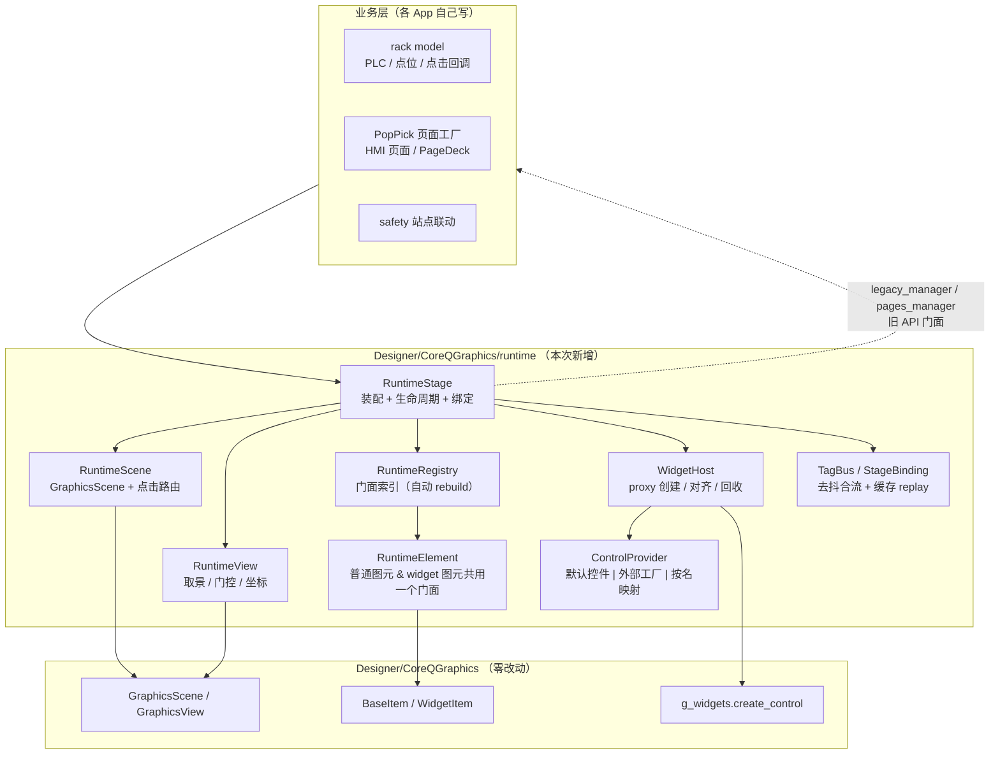
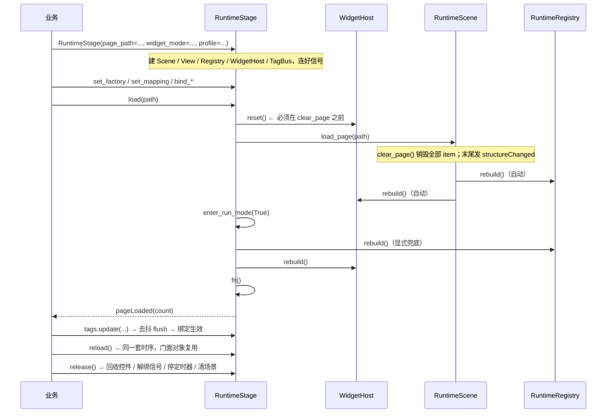

# 统一运行态模板框架设计（CoreQGraphics / runtime）

> 交付日期：2026-11-10　适用范围：`App_PopPick` / `App_RackConfig` / `App_SafetyCar`
> 对应代码：`Designer/CoreQGraphics/runtime/`（新增 2 197 行）
> 配套：`tools/verify_unified_runtime.py`（回归门禁）、`tools/demo_unified_runtime.py`（两个可跑样例）
>
> **本次只新增文件，没有修改任何产品代码、没有修改 `Designer/CoreQGraphics` 核心模块、没有写页面文件。**

---

## 0. 结论先行

你的判断是对的，而且比「不太统一」更严重：**同一个 `CoreQGraphics` 后端上跑着 4 套互不相干的运行态装配**，其中 3 份 `base_element` 是复制粘贴后各自演化的，widget 图元有两条**互斥**的承载路径，几何角点甚至有两种不同定义。

新框架把差异收成**三个显式选项**（`widget_mode` / `fit_mode` / `geometry_profile`），其余生命周期、索引、承载、绑定全部只有一份实现。核心红线已验证：

| 红线 | 结果 |
|---|---|
| `page_1` 1618 图元几何与 rack 适配层逐项对拍 | **0 差异**（bbox / 中心 / 四角 / head-end / 可见性） |
| 装载 + 挂控件 + 改可见性后 `page_data()` 与磁盘 JSON | **逐字相等**（运行态零污染） |
| 回归 `verify_unified_runtime.py` | **0 失败**，11 组 60+ 断言 |
| 两个真实页面样例 | `page_5.json`（rack）/ `page_9.json`（PopPick）均跑通 |

---

## 1. 现状取证：不统一在哪里

### 1.1 四套装配

| 入口 | 文件 | 行数 | 场景 / 视图 | 图元门面 | 索引 |
|---|---|---:|---|---|---|
| PopPick | `App_PopPick/qgraphics_runtime.py` | 1 056 | `RuntimeView(GraphicsView)` | `RuntimeCard`（只包 widget） | `RuntimeSceneManager` |
| Rack 总览 / 单页 | `App_RackConfig/run/rack_scene_adapter.py` | 580 | `RackScene` + `RackSceneView` | `base_element` + 10 个子类 | `SceneManager.m_items` |
| Rack 全局参数 | `App_RackConfig/run/rack_global_paras_widget_v2.py` | 277 | `_ReadOnlyView(GraphicsView)` | 无（直接 `find_item_by_name`） | 无（直接 `widget_proxies`） |
| SafetyCar | `App_SafetyCar/safety_scene_adapter.py` | 898 | `SafetyScene` + `SafetySceneView` | `base_element` + 10 个子类 | `SceneManager.m_items` |

合计 2 811 行，还没算 `hmi/binding.py`（570）、`page_deck.py`（620）和 rack 的 4 个 model。

### 1.2 八条具体冲突

| # | 冲突 | 证据 |
|---|---|---|
| C-1 | **widget 承载互斥** | PopPick 注释：「不复用 `GraphicsScene.set_scene_mode(True)` 自带的预览控件……这里保持 `scene._widget_layer_on = False`，自己管理 proxy」；rack 全局参数面板恰好相反，注释写死「顺序 `load_page()` → `set_scene_mode(True)`，反了会拿到空场景」。两者同时开会在同一批 widget 图元上造两套控件。 |
| C-2 | **几何角点定义不同** | `rack_scene_adapter.get_scene_topLeft()` = `page_bounding_rect().topLeft()`（AABB 角）；`safety_scene_adapter._corner()` = `中心 + R(θ)·(±w/2,±h/2)`（解析式角）。实测 `page_1` 一个 −89.5° 旋转图元：AABB `y=3423.958962` vs 解析式 `y=3563.036711`，**差 139.08 page 单位**。 |
| C-3 | **`getSize()` 口径不同** | safety 用 `projection.inverse_size(_w_view,_h_view)`（未旋转尺寸）；PopPick `RuntimeCard.getSize()` 用 `page_size()`。旋转后 AABB 宽高会互换 / 放大 √2。 |
| C-4 | **换页后包装对象悬空** | 三套 `SceneManager.m_items` / `_cards` 缓存的都是包装对象，而 `load_page()` / `restore()` 会 `clear_page()` 销毁全部 `QGraphicsItem`。rack 靠 `reload()` 里手写 `SceneManager.rebuild()` + `refresh_models()` 补救；设计文档 D-3 已记录这个缺陷。 |
| C-5 | **视图层四份复制** | 都做「NoFrame + 关滚动条 + `QPalette.Base = Window` + 关网格 / 捕捉 + 关导航 + 吞右键」。但 resize 处理分成 `fit`（rack，每次重算缩放）与 `pin`（safety，钉左上角，底部 dock 展开时画面不上移）两派。 |
| C-6 | **装配顺序靠注释约定** | rack v2 三条约定、PopPick 顶层 docstring 大段坐标推导，都是为了让人别把顺序写反。没有一处把顺序固化进代码。 |
| C-7 | **数据刷新各写一份** | PopPick `HmiPagesHost`（去抖合流 + 活跃页订阅 + 后台页快照）、rack model（PLC snap7 直连逐点刷）、safety（信号直发）。「逐点直刷会让 proxy 每来一个点重画整页」这个教训只写在 PopPick 里。 |
| C-8 | **manager 形状不一致** | rack 用 `m_items` / `m_name_items` / `m_sorted_items`；safety 多 `all_items()` / `adapter_of()`；PopPick 只暴露 widget 卡片且 `m_scene` 指向 **view** 而非 scene。 |

---

## 2. 统一后的分层



**关键设计**：`RuntimeElement` 是普通图元与 widget 图元的**同一个门面类**。业务不再需要判断「这是 `base_element` 还是 `RuntimeCard`」；widget 专属能力（`set_widget_factory` / `widget_control` / `set_widget_readonly` / `fit_widget_size`）作为委托方法挂在同一对象上，对普通图元调用是安全的 no-op。

---

## 3. 三条承载路径

### 3.1 普通图元

```
page JSON → GraphicsScene.load_page() → BaseItem
          → RuntimeRegistry.rebuild() → RuntimeElement（只记 item_id）
          → 业务：set_color / context / set_visibility / change_position / clicked
```

* **门面不持有图元对象**：`RuntimeElement.item()` 每次按 id 向场景现查。`clear_page()` 之后最多返回 `None`，绝不会碰到已析构的 C++ 对象（解决 C-4 / D-3）。
* **门面对象跨换页复用**：`rebuild()` 对仍在的 id 复用同一实例，业务 `connect(element.clicked)` 不会断；消失的 id 标 `detached`，所有 setter 安全退化。
* **运行态零污染**：可见性只写 `QGraphicsItem.setVisible()`，不走 `set_page_field("visible")`，因此 `page_data()` 不变。文本 / 颜色按既有 model 口径走 `set_page_field` / `set_style_value`（运行态不保存页面，无副作用）。
* **组隐藏递归**：`_self_visible` + `_eff_visible` 双标志，隐藏前快照直接子项，显示时按快照还原——与 rack `base_element` 语义一致，避免反复切站把整场景冲成一片 True。

### 3.2 widget 图元

```
ControlProvider.signature() 决定要不要重建控件
  ├─ DefaultControlProvider → g_widgets.create_control(record)   （rack 口径）
  ├─ CallableProvider       → factory(host) / factory(host, element)（PopPick 口径）
  ├─ MappingProvider        → {图元名或 id: 工厂 | QWidget | Provider}
  └─ ChainedProvider        → 按顺序尝试，未命中回退默认控件

WidgetHost → QGraphicsProxyWidget（独立顶层项）
```

对齐公式与核心 `_align_widget_proxy`、PopPick `sync_card` **逐位一致**（回归已对拍）：

```
rect = item.boundingRect();  w,h = rect.width(), rect.height()
proxy.resize(w, h)                                   # 不能 setGeometry，它会同步改写 pos
proxy.setTransformOriginPoint(QPointF(w/2, h/2))
center = item.mapToScene(QPointF(0, 0))
proxy.setPos(center - QPointF(w/2, h/2))
proxy.setRotation(item.rotation());  proxy.setZValue(item.zValue() + 0.5)
```

* proxy 不做图元 Qt 子项、不进 `SceneIndex`、不参与 `page JSON`（否则撑大 `sceneBoundingRect`，破坏几何对拍）。
* 位姿没变就一个 Qt 调用都不发（`_pose_state` 缓存），避免大页面每帧全量 `setPos`。
* 回收时 `setWidget(None)` → `hide()` → `setParent(None)` → `deleteLater()`，否则 `setWidget(None)` 会把控件变成无父顶层窗口，留下「幽灵控件」。
* 控件重建后 `controlCreated` 广播，`StageBinding` 自动用 `TagBus` 缓存值补灌（避免切过去先看到一屏 `--`）。

### 3.3 数据总线

```
外部（PLC / 网络 / 定时器）→ TagBus.update(key, value) → _pending
                          → flush_ms 定时器 → valuesChanged(dict)
                          → StageBinding → 图元 / 控件
```

绑定目标保存为**解析函数**而不是对象：`bind_element(key, 名字)` / `bind_control(key, 名字)` 每次现查，换页 / 控件重建自动指向新对象。业务约束（如仓位编号允许 −1）由业务侧加，框架不猜语义。

---

## 4. 生命周期（顺序固化在 `RuntimeStage` 里）



`reset()` 必须在 `load_page()` 之前：`clear_page()` 里的 `scene.clear()` 会删光场景内所有 item（含自建 proxy），等删完再回收就只剩已析构的 wrapper。这是 C-6 的根因，现在由代码顺序保证，不再靠注释。

---

## 5. 三个必须显式选择的口径

**这三件事不能强行合并**，旧项目迁移时按现状选，选错会出现「坐标差几百单位」或「控件挂不上」。

| 选项 | 值 | 对应现状 | 何时选 |
|---|---|---|---|
| `widget_mode` | `"host"`（默认） | PopPick `RuntimeWidgetLayer`；rack 适配层（本无控件） | 新项目 / 需要外部工厂 / 想统一管控件生命周期 |
| | `"builtin"` | `rack_global_paras_widget_v2` 的 `set_scene_mode(True)` | 迁移既有依赖 `scene.widget_proxies` 的 model，`control_of()` 会自动转读核心 proxy |
| | `"none"` | rack 总览页（1618 图元无控件） | 纯图元画面 |
| `fit_mode` | `"fit"`（默认） | `RackSceneView.fit_scene()` | 视口变化时按 `sceneRect` 重算缩放（允许放大）；**`sceneRect` 为 0 时自动回退到全部图元的内容包围盒** |
| | `"pin"` | `SafetySceneView`（基类 `NoAnchor` 钉左上角） | 底部 dock 展开不允许画面上移 |
| | `"none"` | — | 业务自己管变换 |
| `geometry_profile` | `"strict"`（默认） | 新项目 | 四角解析式 + 线段真实端点 |
| | `"rack"` | `rack_scene_adapter` | 四角 AABB + 线段 `head_pos`/`end_pos` 记录 |
| | `"safety"` | `safety_scene_adapter` | 与 strict 同口径，保留别名标注来源 |

> **实测提醒**：`page_1` 一个 −89.5° 旋转图元，`rack` 与 `strict` 的 `get_scene_topLeft()` 差 **139.08 page 单位**。回归第 4 组专门验证这个策略真的生效，不是摆设。

`enter_run_mode()` 封装了一个容易踩的点：`"host"` / `"none"` **刻意不调** `scene.set_scene_mode(True)`（它会按 `widgetType` 造一套默认控件，与 `WidgetHost` 抢同一批图元），只写 `is_run_mode` 并关掉选中 / hover / 拖拽；`"builtin"` 才调核心那条路径。

---

## 6. API 速查

### 装配

```python
from Designer.CoreQGraphics.runtime import create_stage

stage = create_stage(page_path=".../page_5.json",
                     widget_mode="host", fit_mode="fit",
                     geometry_profile="rack", flush_ms=60)
layout.addWidget(stage.view)          # 或 stage.attach(layout)
stage.load()                          # → pageLoaded(count)
stage.reload(); stage.fit(); stage.release()
stage.report()                        # 一行状态摘要
```

### 普通图元

```python
e = stage.element_of("仓位编号1")
e.set_color("#ff0000"); e.context = "运行中"
e.set_visibility(False); e.change_position(QPointF(100, 200))
e.clicked.connect(on_click)
stage.set_interactive(["HMI1", "HMI2"], types=("group", "checkbox"))
stage.element_of("HMI1").get_scene_center_pos()   # page 坐标
```

### widget 图元

```python
stage.set_factory("Page0", lambda host: MyHmiPage(host))       # 外部工厂
stage.set_mapping({"Page1": factory_b, "Page2": a_qwidget})    # 批量
stage.set_provider(MyCustomProvider())                          # 整页换 provider
w = stage.widget("仓位编号1")          # QCheckBox / QSpinBox / 自定义 QWidget
stage.widgets.set_readonly(iid, True)  # 只挡输入，不改外观
stage.widgets.proxies()               # {iid: QGraphicsProxyWidget}
```

### 数据绑定

```python
stage.bind_control("db41.slot1", "仓位编号1")                  # 默认按 setValue/setChecked 探测
stage.bind_element("plc.status", "状态文本",
                   apply=lambda e, v: setattr(e, "context", str(v)))
stage.bind("custom.key", some_object, apply=lambda t, v: ...)
stage.tags.update_many({...}); stage.tags.flush_now()
```

### 旧 API 门面（迁移期）

| 旧接口 | 新门面 |
|---|---|
| rack `SceneManager.m_items` / `m_name_items` / `m_sorted_items` / `findItemByName` / `findItem` / `rebuild` | `stage.scene_manager`（`legacy_manager()`） |
| PopPick `RuntimeSceneManager.m_sorted_items` / `findItemByName` / `all_items` / `m_scene` | `stage.pages_manager`（只暴露 widget 卡片，`m_scene` 指向 view） |
| `base_element` / `RuntimeCard` | `RuntimeElement`（两者方法并集） |
| `view.refresh_embedded_widgets()` / `release_embedded_widgets()` / `delete_all_elements()` / `load_scene_file()` / `set_scene_mode()` / `sceneToView()` / `window_to_page()` | `RuntimeView` 同名方法 |
| `card.set_widget_factory()` / `set_motion_cache()` / `set_widget_fast_paint()` | `RuntimeElement` 同名方法（后两个是**明示的兼容钩子**，见 §10） |

---

## 7. 迁移路线（建议分三阶段，不要一次改完）

### 阶段 0：新代码直接用（现在）

任何新的运行态窗口从 `RuntimeStage` 起手，不再复制 `base_element`。两个样例可以直接抄：

```bash
.venv/Scripts/python.exe tools/demo_unified_runtime.py --mode rack
.venv/Scripts/python.exe tools/demo_unified_runtime.py --mode poppick
.venv/Scripts/python.exe tools/demo_unified_runtime.py --mode both --show --seconds 5
```

### 阶段 1：RackConfig（风险最低，先做）

`rack_global_paras_widget_v2.py` 是最小的试点（277 行、9 个图元）：

1. `widget_mode="builtin"` 起步——`RackGlobalParasModelV2` 现在依赖 `scene.widget_proxies`，`stage.widgets.control_of()` 会自动转读，model 可先不动。
2. 把 `_ReadOnlyView` 换成 `stage.view`，删掉重复的视图配置。
3. `RackStoreModel` / `RackStatusPanelModel` / `RackHmiConfigModel` / `RackProcessModel` 的构造参数从 `SceneManager` 换成 `stage.scene_manager`，`findItemByName` 拿到的是 `RuntimeElement`（方法名兼容）。
4. 验证 `geometry_profile="rack"`，跑 `tools/verify_rack_stores_v2.py` + `tools/verify_unified_runtime.py`。
5. 最后把 `widget_mode` 切到 `"host"`，删掉 `rack_scene_adapter.py` 与 `SceneManager.rebuild()` 调用链。

`rack_stores_widget_v2.reload()` 里那串 `clear_page → load_page → set_scene_mode → SceneManager.rebuild → refresh_models` 直接换成 `stage.reload()`。

### 阶段 2：SafetyCar

`geometry_profile="safety"`、`fit_mode="pin"`、导航按需开。注意 `SafetySceneView` 还兼着「业务眼里的 scene」（提供 `selectionChanged` / `run_mode_station_change` / `current_selected` 等代理属性），这部分**不在框架里**，迁移时要保留一层薄代理或继续用 `SafetySceneView` 包住 `RuntimeView`。`run_mode_station_change` 的载荷是双形态，别改签名。

### 阶段 3：PopPick（最后，风险最高）

`PageDeck` 的动画链路、`HmiPagesHost` 的位图快照缓存、最大化 refit、`_DeferredNativeClose` 都是 PopPick 特有的，不要一次搬：

1. 先让 `PageDeck` / `HmiPagesHost` 接 `stage.pages_manager`（接口已对齐），`RuntimeView` 的 `sceneToView` / `window_to_page` / `set_view_scene_rect` 已提供。
2. `set_widget_factory` / `fit_widget_size` / `sync_widget_geometry` / `set_zValue` 在 `RuntimeElement` 上都有对应实现。
3. **位图快照缓存与动画期精确标脏暂不迁移**（见 §10），先保留 `qgraphics_runtime.py` 的 `RuntimeWidgetLayer`，等框架补上 `SnapshotPolicy` 再切。

---

## 8. 验证结果

```bash
.venv/Scripts/python.exe tools/verify_unified_runtime.py     # 0 失败
```

11 组断言覆盖：

| 组 | 内容 |
|---|---|
| 1 | 装载 1618 项、索引、widget 识别、排序稳定、`page_data` 逐字相等 |
| 2 | 组隐藏递归 + 快照还原 + **可见性操作后 JSON 仍零改动** |
| 3 | **与 `rack_scene_adapter` 1618 图元几何 / 可见性零差异** |
| 4 | `strict` / `rack` 解析式角与 AABB 角确实不同，切回可还原 |
| 5 | proxy 位姿（pos / size / rotation / z / 变换原点）、外部工厂替换、只读、占位优化 |
| 6 | 点击路由按下/释放、拖出图元外不误触发 |
| 7 | `TagBus` 合流、`bind_element` / `bind_control`、控件重建后自动 replay |
| 8 | reload 门面复用 / 信号保住 / 内存换页后 detached 门面所有 setter 安全 |
| 9 | `builtin` / `none` 两种承载模式 |
| 10 | 旧 API 门面、坐标互逆、resize 取景 |
| 11 | `release()` 彻底回收且可重复调用 |

另外跑过既有回归确认无回归（见 §12）。

---

## 9. 未覆盖能力（诚实清单）

框架**没有**假装做完下面这些，迁移时别误判：

| 能力 | 现状 | 影响 |
|---|---|---|
| 位图快照缓存 / 后台页静态化 | `set_motion_cache` / `set_widget_fast_paint` 是明示的 no-op 记账钩子 | PopPick 后台页仍是真实控件；7 张 750×1000 同时刷新会掉帧 |
| 动画期精确标脏 | `set_exact_repaint()` 是兼容钩子，不吞 `update()` | PageDeck 动画每帧可能整视口重绘 |
| `HmiClient`（snap7 / OPC UA 客户端） | 只提供 `TagBus` 合流入口 | 业务自己把值推进来 |
| 活跃页订阅 / 消息缓存 / 时钟页 | 未实现 | `HmiPagesHost` 仍需保留或自行移植 |
| safety 的 SceneMode 双形态载荷信号 | 未提供代理 | `SafetySceneView` 的薄代理层要保留 |
| C++ / Qt6 运行态窗口嵌入 | 无关（纯 PySide6） | 独立议题 |
| 撤销 / 设计态编辑 | 运行态只读，不提供 | 仍走设计器 |

---

## 10. 风险与注意事项

| 风险 | 说明 / 对策 |
|---|---|
| 直接写 `scene._widget_layer_on` | 集中封装在 `RuntimeStage.enter_run_mode()` **一处**。核心若日后给 `set_scene_mode` 加 `widgets=` 参数，只改这一处。 |
| `geometry_profile` 选错 | 迁移既有 model 先按现状选（rack / safety），**别用默认 strict 硬套**；跑一次几何对拍再切。 |
| `set_page_center` 对带父图元被拒绝 | 子图元位姿只能由父带动（`translate_locked()`）。`RuntimeElement.setPos` / `set_angle` 对有父图元可能不生效，与核心语义一致。 |
| proxy 与内置 layer 同时开 | `widget_mode` 互斥保证不会；若业务手动调 `scene.set_scene_mode(True)` 会破坏，文档已标注。 |
| `ChainedProvider` 归属判定 | `signature()` 只查 mapping 的 lookup，不真的造控件；自定义 provider 请同时实现 `signature()`，否则字段变化可能不触发重建。 |
| 门面跨换页复用但 name 变了 | `rebuild()` 会 `reindex_names()`，`by_name` 全量刷新；业务若按名字缓存对象，应在 `pageLoaded` 后重取（或用 `bind_*` 的解析式绑定）。 |

---

## 11. 文件清单

**新增（本次交付）**

| 文件 | 行数 | 作用 |
|---|---:|---|
| `Designer/CoreQGraphics/runtime/__init__.py` | 86 | 包导出 + `create_stage()` |
| `Designer/CoreQGraphics/runtime/elements.py` | 893 | `RuntimeElement` / `RuntimeRegistry` / `GeometryProfile` / `LegacyManager` |
| `Designer/CoreQGraphics/runtime/widgets.py` | 469 | `ControlProvider` 家族 + `WidgetHost` |
| `Designer/CoreQGraphics/runtime/view.py` | 324 | `RuntimeScene` / `RuntimeView` |
| `Designer/CoreQGraphics/runtime/stage.py` | 425 | `RuntimeStage` / `TagBus` / `StageBinding` |
| `tools/verify_unified_runtime.py` | 375 | 回归门禁（0 失败） |
| `tools/demo_unified_runtime.py` | 228 | rack / poppick 两个可跑样例 |
| `docs/unified_runtime_template_design.md` | 本文 | 设计与迁移文档 |

**未改动**：`Designer/CoreQGraphics/g_*.py`、`App_PopPick/**`、`App_RackConfig/**`、`App_SafetyCar/**`、任何 page JSON。

---

## 12. 与既有回归的关系

新增框架是纯增量包，不参与既有 import 链，因此不改变任何既有回归结果。本次复查的相关回归：

* `tools/verify_unified_runtime.py`：**0 失败**
* `tools/verify_core_qgraphics_ui.py`：**0 失败**
* `tools/verify_core_qgraphics_incremental.py`：**0 失败**
* `tools/verify_safety_car_v2.py` / `verify_rack_stores_v2.py` / `verify_pop_pick_qgraphics.py`：通过
* `tools/verify_core_qgraphics.py`：**1 项既有失败**（「combobox 灌入多行选项」），来源是工作区里未提交的 `g_widgets.py` 改动多加了 `选项2/选项3`，与本次无关。

> 详细结果见命令输出；若你的工作区已修掉那个 combobox 改动，该项会恢复通过。

---

## 13. 首个落地项目：App_test_fixture（2026-11-10）

`App_test_fixture/` 用本框架从零落地了一套运行态（普通图元 + widget 图元），
页面 `res/myDesigner/scene/test_fixture.json`（20 图元：6 widget / 5 rect /
5 text / 2 polygon / 2 group）。旧的 5 个 PopPick HMI 移植文件保持原样，
不被新包导入。

**落地时修掉一个框架缺陷**：`RuntimeView.fit_scene()` 在 `sceneRect` 全 0 时
把 `scene.fit_rect()`（**视图坐标** AABB）又过了一次 `projection.rect()`，
造成二次投影——实测 `centerOn` 落到 (1072, 568)，而内容在 (-2300, -4300)
附近，画面完全空白。修复：回退分支直接用 `fit_rect()`，只有 header 里保存的
`sceneRect`（page 坐标）才走投影。修复后 20 个图元 100% 落在可视区（scale 0.81）。
`verify_unified_runtime.py` 等既有回归复查全绿。

**另一个需要业务侧配合的口径**：运行态改色 / 位移若走核心的
`set_fill_color()` / `set_page_center()`，会经 `set_page_field` 与
`apply_rigid_pose` 写进 `_page`，破坏「`page_data()` == 磁盘 JSON」。
`fixture_runtime.CleanVisuals` 的做法是：改色只写 `item._style` + `update()`；
位移走 `change_position()`（刚体传播带动子项）后，把父与全部后代的 `_page`
从装载时快照还原并 `mark_clean()`。因此 Qt 位置确实变了，设计数据零改动。
注意还原后 `get_scene_center_pos()` 读到的是记录值（原始值），
**判断实际位置必须用 `item().sceneBoundingRect()`**；联动一律用绝对目标值
计算，不依赖读回，连续推送不漂移。

**Modbus 预留**：数据源抽象为 `DataSource`（`valuesChanged` / `write` / `stop`），
默认 `DemoDataSource` 可跑；接现场只需填 `MODBUS_REGISTER_MAP` 并注入
`set_reader` / `set_writer`（轮询式）或在客户端回调里调 `submit()`（推送式），
业务与图元联动代码不用改。

门禁 `tools/verify_test_fixture.py`（8 组，0 失败），入口
`python -m App_test_fixture.fixture_app --source demo|none|modbus`。
